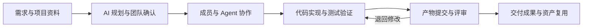

# 铸码 Zhuma


**铸码是面向团队与 Agent 协作的 AI 研发工作台。** 它支持用 AI 拆解和规划任务，把需求、分工、开发执行、测试与评审组织在同一项任务中，让负责人看清进展，让成员和 Agent 按职责协作。

团队研发需要把需求说明、工程代码、检查结果和交付责任连起来。铸码围绕任务共享资料、安排工作、保存提交与评审记录，并将常用工作流、Skills 和 Agent 专家沉淀为可复用资产。



图示为典型研发协作流程；具体节点、角色和依赖可按项目调整。产品设计、角色分工及工程演练见[产品与功能导读](docs/product-overview.md)。

## 核心优势

- **AI 辅助规划，团队确认后执行**：结合目标、参与者和可用资源生成工作步骤与依赖；也可选择已有工作流或从空白开始，继续编辑分工、输入与交付要求。
- **多层级组织人与 Agent 的工作**：工作节点可继续拆分为子工作流，列表、工作流与工作树帮助团队查看整体结构和当前职责；成员从“我的工作”处理待办，关键节点可指定评审人。
- **连接真实开发环境**：在已授权本机工作区选择原生 Agent 或码道 CLI 处理开发任务，在同一工作会话中查看记录、补充要求、停止或明确继续。
- **按提交版本核对交付质量**：文字、代码文件和测试报告通过固定提交交付；评审人查看同一版本、留下意见、退回修改，后续节点使用已接受的成果。
- **将团队经验沉淀为资产**：上传真实资料文件，维护工作流、Skills 和 Agent 专家，支持导入、复制和版本管理；换个项目可以继续选用并调整分工。
- **支持不同设备协作**：Windows 和 macOS 客户端可连接同一团队共享服务；成员在各自电脑处理工程，团队集中查看任务进展、提交和评审记录。

## 下载与支持平台

[下载正式版本](https://github.com/dolibali/zhuma/releases/latest) · [查看全部版本](https://github.com/dolibali/zhuma/releases) · [v1.5.1 发行说明](docs/release-v1.5.1.md)

| 平台                | 下载内容                           |
| ------------------- | ---------------------------------- |
| Windows x64         | 桌面安装器，文件名含 `windows-x64` |
| macOS Apple Silicon | arm64 桌面 DMG                     |
| Linux amd64         | 共享服务镜像、便携服务包及部署材料 |

下载后核对同版 `SOURCE.json` 和 `SHA256SUMS`。Windows 安装器当前未签名，macOS 为 ad-hoc 签名、未公证；自动更新尚未提供。Linux 提供共享服务，不提供桌面客户端。可下载文件及发布状态以正式 Release 为准。

## 快速上手

1. **安装并登录**：选择对应平台的正式安装包。首次使用创建本机账号和团队；接入团队共享服务时，在“连接设置”填写操作者提供的服务地址，使用该服务的成员账号登录。
2. **创建任务**：在“团队工作台”新建项目和任务，描述目标，选择参与的成员与 Agent 专家。
3. **编排计划**：选择“AI 规划”“使用工作流”或“从空白开始”，调整节点、分工、依赖及评审人，保存并确认计划。使用 AI 规划前，需要由服务操作者配置规划模型；人工编排不要求模型。
4. **开始处理**：进入“我的工作”，提交人工产物，或选择“使用 Agent”“运行工作流”。本机执行可选原生 Agent 或已配置的码道 CLI；执行前配置所需模型，确认工作区权限和交付范围。查看任务或重开应用不会自动执行。
5. **提交与评审**：提交文字或文件，由指定真人或独立 Agent 专家评审。收到退回意见后修改重提；全部指定评审通过且本轮运行结束后接续下游。
6. **查看成果**：在节点“上游输入”和项目“资料与成果”查看已接受内容。“我的工作”标题右侧的“导出”菜单可下载已记录数据的 JSON 或 CSV。

完整操作见[工作台使用指南](distribution/workbench/README.md#正常操作)。客户端安装不会自动升级团队共享服务，已有数据与配置的升级安排见[服务部署说明](distribution/server/README.md)和本版发行说明。

## 项目结构与源码启动

```text
packages/       产品领域、上下文、运行适配与客户端代码
resources/      工作流、技能和专家资源
scripts/        开发、构建与检查入口
distribution/   桌面、共享服务与部署模板
docs/           架构、运行及开发说明
tests/          分层验证约定
examples/       独立示例与演示项目
```

源码环境使用 Node.js **24.15.0**、pnpm **12.4.2** 和可用的 Corepack、Git。安装版桌面无需这套源码工具；Linux 便携服务包的运行要求单独见指南。

在完成工具安装后，从自选目录取得完整源码并准备桌面构建目录：

```sh
git clone --recurse-submodules https://github.com/dolibali/zhuma.git
cd zhuma
pnpm install --frozen-lockfile --ignore-scripts
pnpm run doctor
pnpm desktop:prepare
```

桌面源码入口面向 macOS arm64 和 Windows x64。启动前先按[指南第 3 节](docs/getting-started.md#3-从源码启动桌面)为当前平台设置新的状态目录，再执行 `pnpm desktop:dev`，避免复用已安装应用的 profile。完整依赖准备、可选共享后端、Linux 便携/镜像启动、端口与数据保留见[源码运行与本地部署指南](docs/getting-started.md)。根 Workspace 保持独立，具体分包和实现来源见技术文档。

## 技术文档

| 文档                                           | 内容                         |
| ---------------------------------------------- | ---------------------------- |
| [产品与功能导读](docs/product-overview.md)     | 核心优势、角色协作和工程演练 |
| [源码运行与本地部署](docs/getting-started.md)  | 从克隆到启动、配置和停止     |
| [开发指南](docs/development.md)                | 环境准备、开发命令与协作约定 |
| [架构说明](docs/architecture.md)               | 模块边界、接口与实现来源     |
| [桌面发行指南](distribution/desktop/README.md) | 源码构建、平台打包与来源核验 |
| [共享服务部署](distribution/server/README.md)  | 服务运行、配置与数据保留     |
| [测试说明](tests/README.md)                    | 各层验证方法及证据边界       |
| [产品范围](docs/product-coverage.md)           | 已有能力、保留范围与退出条件 |

v1.5.1 范围与发行记录见[工作项 #449](https://github.com/dolibali/zhuma/issues/449)，协作入口见[总索引 #25](https://github.com/dolibali/zhuma/issues/25)。

## 许可

自有代码采用 [MIT License](LICENSE)。依赖和资源保留各自的版权、许可与来源，见[第三方说明](THIRD_PARTY_NOTICES.md)；发行包同时携带相应许可文件。
