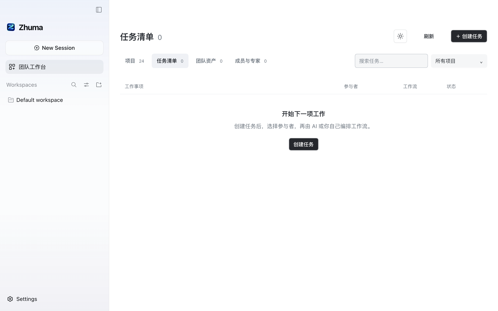
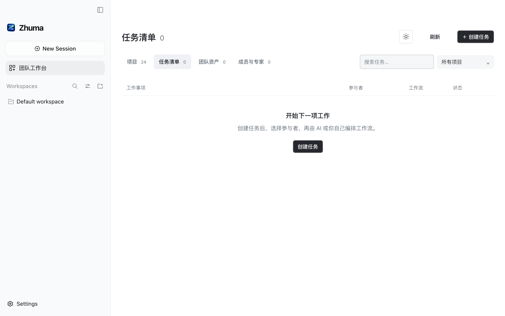
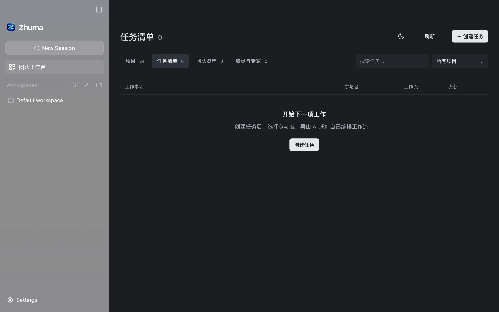
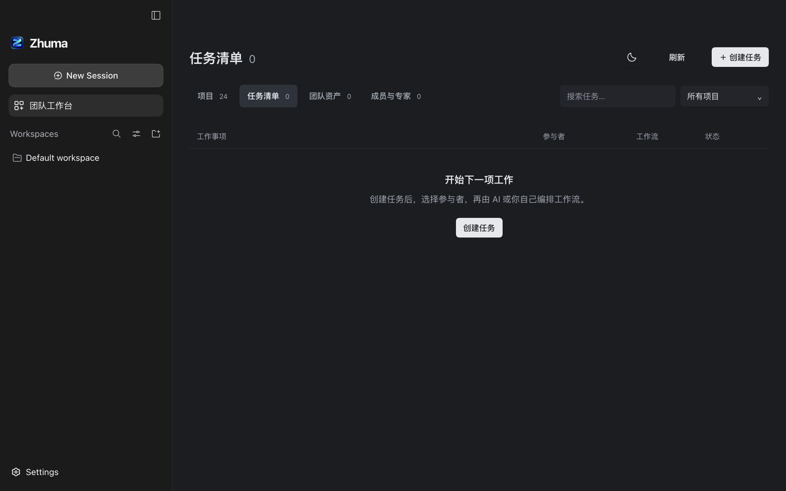

# A-DESKTOP1：中性侧栏与桌面验证

macOS 侧栏原有蓝紫渐变和 40%／50% 透明填充，会叠加窗口材质与壁纸颜色。本次发行补丁改为官方现有 `--dsw-specific-sidebar-fill` 不透明背景：浅色 `#f9fafb`、深色 `#1b1b1c`。没有增加主题状态、修改 nativeTheme 同步、缩放倍率或拖动规则。

## 构建与证据范围

- 基线为 Zhuma `bb09057`、固定 DSH `687f282e8625c6b8d11ff58211a90524be2e4317`。完整发行补丁在该提交的独立临时 Git 根检查并应用；官方 `ui-layout` 使用自身 tsdown 配置重建，品牌参数为 Zhuma。
- 验证实例是官方开发应用的独立副本，使用新的 DSH_HOME、userData 和公开虚构数据（24 个项目、零任务）。通过独立 Profile 加载重建的官方 layout 包和 PR #8 最终工作台构建；没有热改用户正在使用的实例，也没有调用模型。
- 实际服务的 layout 可执行代码与产物逐字匹配；服务器改写的 sourceMappingURL 不参加比较。产物 SHA-256 为 `7ed4cb21ec4261207efd7bd28a0fb32586121a240620b44b83d683f1c11345e2`，记录在 [theme-metrics.json](theme-metrics.json)。这是开发构建验证，不是安装包验收。

## 前后对照

同一项目数据、所有项目筛选、菜单收起、原生窗口失焦、100% 实际缩放、1280×800 内容区、DPR 2，截图为 2560×1600 原始页面像素。以下由实际 Electron 页面捕获，不含系统菜单或原生交通灯。

| 主题 | 修改前                          | 修改后                         |
| ---- | ------------------------------- | ------------------------------ |
| 浅色 |  |  |
| 深色 |   |   |

[跟随系统深色](after-system.png) 使用同一深色配色，没有第三套“系统”颜色。最终截图已人工查看。

## 实际验证

- `pnpm check` 通过：工程边界、品牌资源、格式、类型检查及 134 项测试；规划用例属于契约测试。完整上游补丁的应用及反向检查均通过，固定子模块仍干净。没有为纯 CSS 改动添加镜像测试。
- 当前 macOS 配色为深色。浅色、深色、跟随系统三种偏好分别核对 renderer、媒体查询和 Electron nativeTheme；取消 Playwright 默认媒体模拟后再采集最终数据。跟随系统解析为深色，未把自动化的 light 媒体模拟当成真实系统浅色。
- 三种偏好分别验证原生窗口聚焦／失焦，侧栏计算颜色与不透明背景不变。关闭并重新启动后恢复 system，renderer 与 nativeTheme 均为深色。[主题及焦点数据](theme-metrics.json)。
- 浅深色各验证实际 `webContents.setZoomFactor(1 / 1.25 / 2)`。此次缩放测试的原生内容区是 1280×820，对应 CSS viewport 1280×820、1024×656、640×410；与前后对照截图尺寸分开记录。六组项目菜单均在视口内、字号 13px，实际搜索并选择长中文项目通过。[缩放数据](zoom-metrics.json)、[浅色 200% 展开态](after-light-200-menu.png)、[深色 200% 展开态](after-dark-200-menu.png)。
- 原生按钮进入全屏后 `isFullScreen=true`，内容区 1512×949，菜单搜索选择可用。原生 Window 菜单还原后恢复 1280×800，创建弹窗的输入、项目键盘选择和取消通过，没有创建任务。[窗口数据](window-checks.json)。

## 尚未验收

- **原生拖窗**：点击坐标用可信 Appearance 输入事件校准，再以同一位移分别拖动官方 topStrip 与工作台标题栏，两者均没有产生窗口坐标变化。额外确认原生 focus=true 后重复，结果相同；部分自动化观察还返回 ScreenCaptureKit -3811 或 windowNotFoundAtPosition。尚不能把问题归因于产品或输入工具，因此未据此修改拖动 CSS，也未将 setBounds 当作拖动成功。[诊断数据](drag-diagnostic.json)。
- **实际系统浅色及系统配色切换**：本机真实系统为深色；未改变用户的系统偏好。需要在真实浅色环境补齐矩阵，媒体模拟不能替代该证据。
- 这批只覆盖桌面侧栏和相关回归，不认证多人身份、Agent 执行、工作流交付或安装包。
