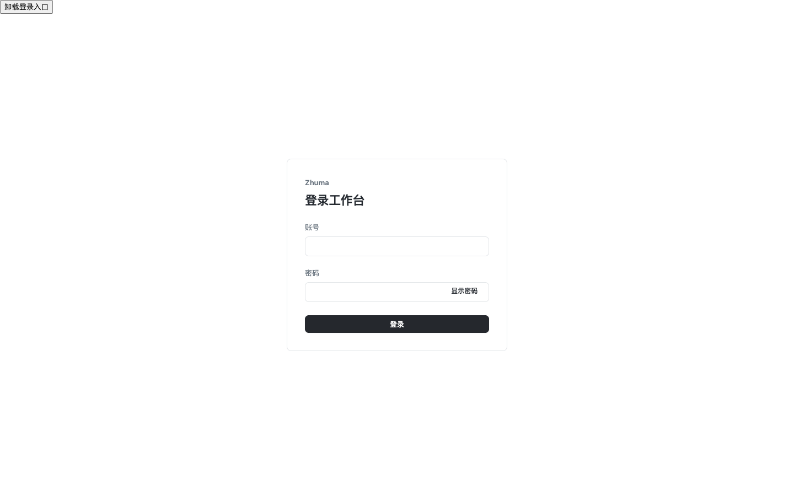
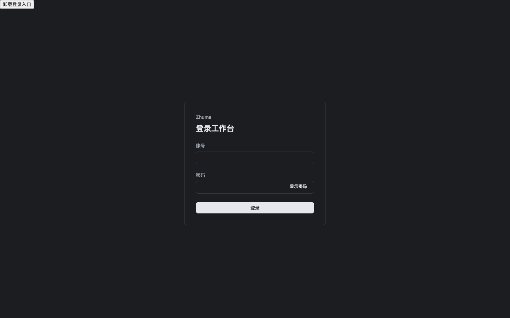
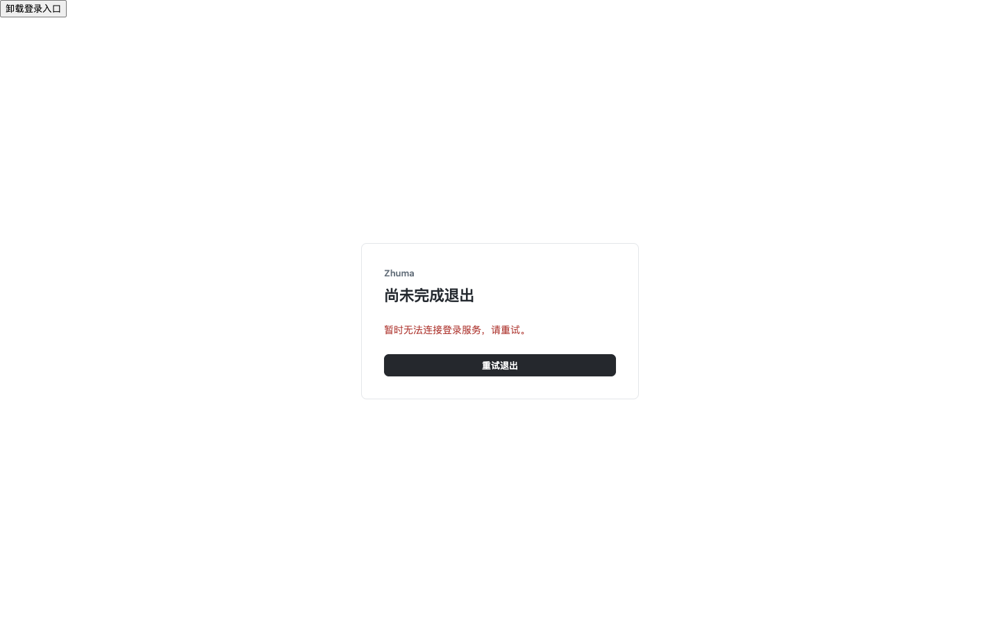
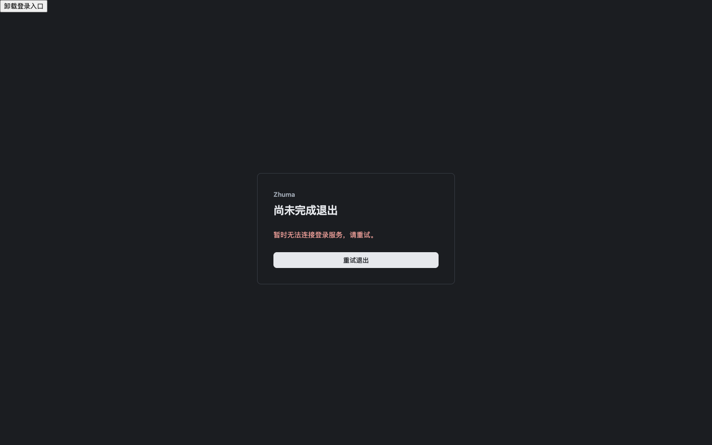

# 成员登录：客户端契约与界面证据

实现：`bb08789b65cb2d5dd61d6b2ec2f8284b344218d4`；基线：`b6fe7c4add9af1e8bdd783ba9fe9cf63fa3704ed`。[PR #46](https://github.com/dolibali/zhuma/pull/46) 是新增的 opt-in 客户端切片，没有旧登录画面对照，尚未接入正式入口。

17 张图由协调者在独立 Chromium 中拍摄，使用未改动的 `?member-login&strict` HTTP 响应重放入口。每组浅深图保持相同数据、状态与视口。A 仅复制 PNG 和 [evidence.json](evidence.json)，核对全部图片的尺寸、字节数和 SHA-256，并逐图查看；本次证据增量不修改代码、不另开浏览器。

图左上的“卸载登录入口”、账号页的“会话契约预览”及临时内容／失效按钮均是预览控制，不是正式产品入口。图片和测量只证明 Client 契约及渲染；没有真实成员 cookie、Host、空间授权或原生系统主题验收。CSS zoom200% 仅是重排探针，不是原生桌面或真实浏览器缩放验收。

## 1440×900 主要状态

| 默认登录 · 浅色                           | 默认登录 · 深色                          |
| ----------------------------------------- | ---------------------------------------- |
|  |  |

| 退出失败 · 浅色                                                      | 退出失败 · 深色                                                     |
| -------------------------------------------------------------------- | ------------------------------------------------------------------- |
|  |  |

## 其余视口与状态

| 场景                                            | 浅色                                         | 深色                                        |
| ----------------------------------------------- | -------------------------------------------- | ------------------------------------------- |
| 默认登录 · 1280×800                             | [图片](login-light-1280x800.png)             | [图片](login-dark-1280x800.png)             |
| 默认登录 · 1920×1080                            | [图片](login-light-1920x1080.png)            | [图片](login-dark-1920x1080.png)            |
| 默认登录 · 1024×768                             | [图片](login-light-1024x768.png)             | [图片](login-dark-1024x768.png)             |
| 长账号 · 1024×768 · CSS zoom200% 重排           | [图片](login-light-1024x768-css-zoom200.png) | [图片](login-dark-1024x768-css-zoom200.png) |
| 登录中 · 1440×900                               | [图片](login-busy-light-1440x900.png)        | [图片](login-busy-dark-1440x900.png)        |
| 当前账号与预览草稿 · 1440×900                   | [图片](account-light-1440x900.png)           | [图片](account-dark-1440x900.png)           |
| 错误后密码清空、重遮蔽并回到密码焦点 · 1440×900 | [图片](login-error-light-1440x900.png)       | 未另拍该状态                                |

## 同实现的分层验证

- A 的 `pnpm check` 214/214；协调者独立 `pnpm check` 214/214，新增浅深界面契约 4/4。
- [CI 39997525312](https://github.com/dolibali/zhuma/actions/runs/39997525312) 在实现 head 通过：Node 214/214、界面契约 104/104。
- 协调者实际操作 Tab、密码显示与键盘提交；错误后清空并重遮蔽密码、焦点回到密码。独立延迟探针记录单次登录请求、busy 禁用以及登录前／中按钮尺寸均为 334×32；切主题保留预览草稿；退出 503 后旧内容卸载且未回显错误正文。测量与图片清单见 `evidence.json`。

这些是上述实现版本的 HTTP 重放证据，不替代 #31 的真实会话、过期／撤销、重启、三账号／两团队和正式空间入口验收。接线边界见[成员登录客户端](../../member-login-client.md)；#27／#28／#29／#32 的依赖和退出条件保持不变。
