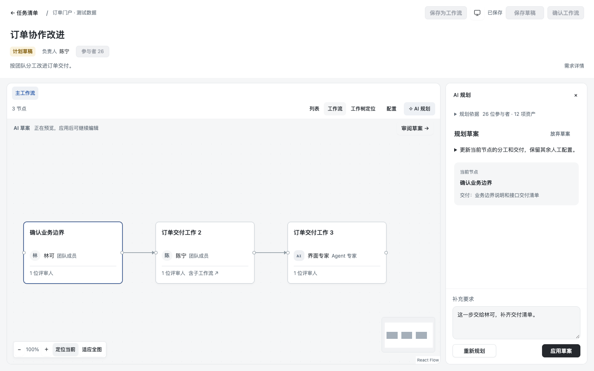
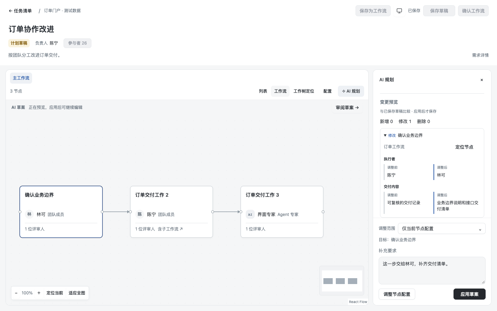
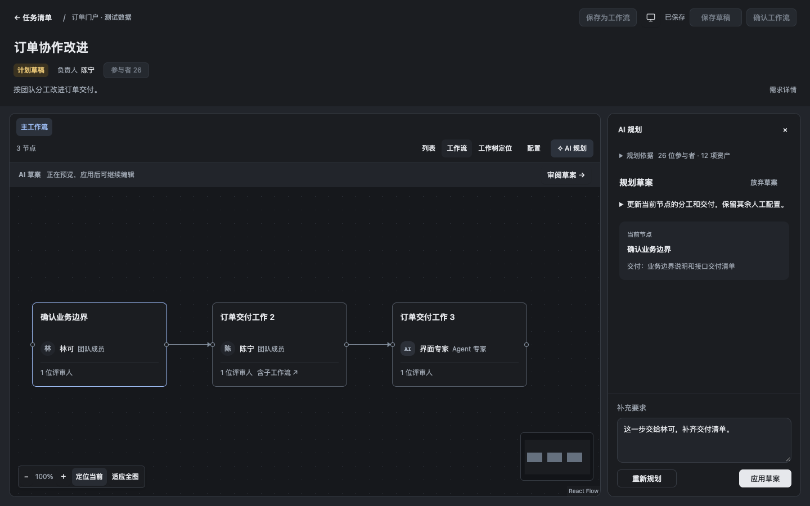
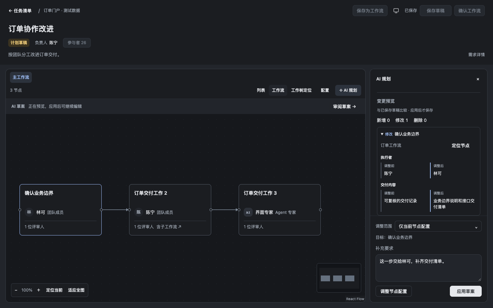

# 局部规划：同状态界面对照与验证

前：主线 `79a4466f2dc26cedf8495be58a16078f663b9fa5` 的 Client 源码，在独立临时目录构建同一浏览器 harness；后：`900d05d9c848bf17c1f8ce45efeda28fef40a2eb`。两者都是 **Chromium 响应重放**，不是真实模型、Host 持久化或原生窗口证明。

相同任务有主工作流 3 个节点及一个下层工作流；同一返回草案只把首节点执行者由陈宁改为林可，并补充交付说明，其他人工配置保持不变。截图均为 1440×900、同一主题、未应用状态，截图时保存命令为 0。后图滚动右侧正文以展示前后值，画布和任务相同；不把隐藏面板当作删除功能。

| 主题 | 调整前界面                                       | 本批界面                                              |
| ---- | ------------------------------------------------ | ----------------------------------------------------- |
| 浅色 |  |  |
| 深色 |   |   |

任务／结果摘要及来源见 [前图记录](before-proof.json)、[后图与测试记录](after-proof.json)。截图只包含合成任务数据和本项目界面。

## 验证

- `pnpm check`：**200/200**，类型／格式／包边界及契约检查通过；固定 DSH 上游 `687f282e8625c6b8d11ff58211a90524be2e4317` 干净。
- 完整 `pnpm test:ui`：**98/98**，覆盖原有 88 个浅／深色场景和本批 5 类各两主题场景。失败不重试、不忽略；首次小窗用例修正为先关闭配置抽屉再切换规划入口，产品没有通过绕过抽屉来通过测试。
- 领域范围：目标字段允许修改；同一节点未授权的评审／资源／交付、其他节点、嵌套、依赖、位置、顺序及增删均拒绝。差异包含纯位置／顺序变化，不因对象属性顺序误报。
- Host 服务契约：只消费可信任务／持久化未应用提案；越界一次修复、再失败拒绝；空图问题回复不能丢掉基线；错误／旧提案、未知节点、旧版本、请求 ID 改范围拒绝；失败、取消不写任务。这里的存储和模型是契约端口，不是真实服务持久化证明。
- 浏览器：重要前后值与定位、调整前／规划结果切换、未应用提案的本轮对比、范围请求字段、取消与迟到响应、删除前定位、无变化禁用、双击只保存一次、刷新重开及 720×600 长内容操作。刷新是内存重放协议，不是磁盘重启。

同一代码的 Host／Client bundle 构建通过并记录摘要；没有用浏览器重放认证其实际 Native 加载，也没有调用真实供应商。本批不认证模型效果、多人授权、原生桌面、安装包、Windows 或系统主题切换。

## 变更面与集成

领域新增 `planning-changes` 与公开导出、规划请求／提示词；Host 只在既有 workbench-service 加规划范围校验；Client 改 WorkbenchApi、TaskEditor、PlanningChanges 与现有主题变量 CSS，并补对应领域／服务／RPC／浏览器回归。未改身份、执行、产物、评审、导航注册或上游。与待集成分支的交点是公共导出和同一 bundle 重建，合入时按实际范围复核。

操作与兼容说明见[局部规划](../../planning-adjustments.md)。FR02／04／13 的真实模型质量和结构调整等其余退出条件继续保留，不以该切片的数量关闭完整需求。
