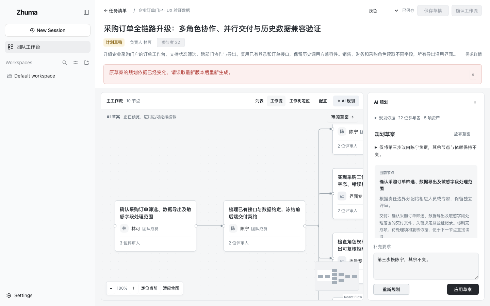
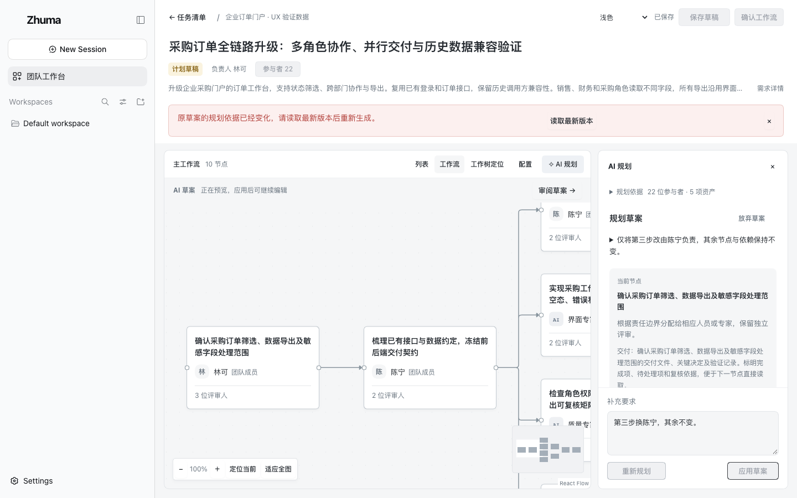
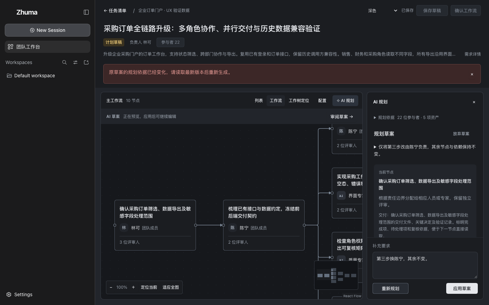
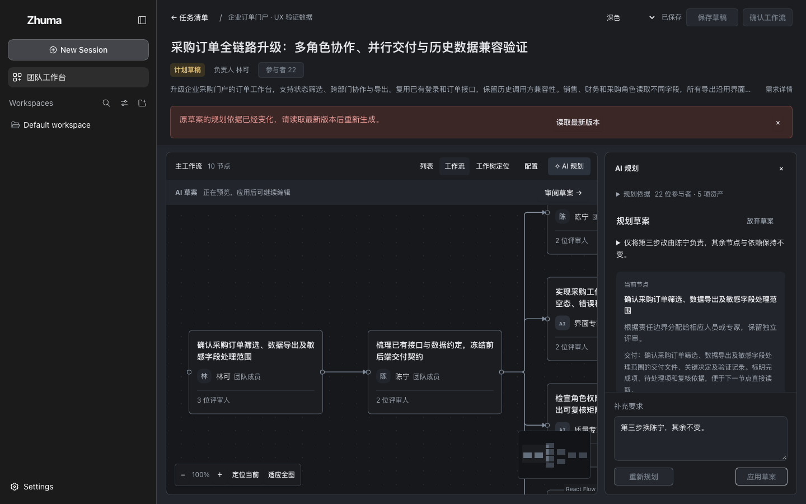

# 未应用草案的调整与过期恢复

日期：2026-10-22。修改前是 `49f958f` 的 TaskEditor 和客户端 API；其他 UI 源文件与本批一致。截图在隔离官方 DSH Web 页面实际渲染，未做图像编辑；均为 1440×900 完整视口、同一公开演示数据、同一十节点预览、100% 缩放。只替换浏览器加载的自有模块来重现旧 UI，不改上游。

两轮规划响应使用确定性重放：首份十节点草案，第二份仅更换第三步执行者。第三次请求注入相同 `conflict` 错误。该错误的未知/跨任务/过期引用检查已另在真实 Host 验证；图片中的模型响应和错误注入不算新的真实模型调用。

| 修改前 · 49f958f                                   | 修改后 · 本批                                     |
| -------------------------------------------------- | ------------------------------------------------- |
|  |  |
|   |   |

修改后保留正在审阅的草案，并提供“读取最新版本”；已知过期时禁用重新规划和应用。普通生成失败或取消仍保留有效草案的可用动作。正常布局、样式和尺寸未变，原有 [A-UX1b 对照](../pr-2-ux1b/README.md) 继续作为布局证据；本批上下文引用、持久化边界和 131 项检查见 [验证记录](../../ui-validation.md)。
