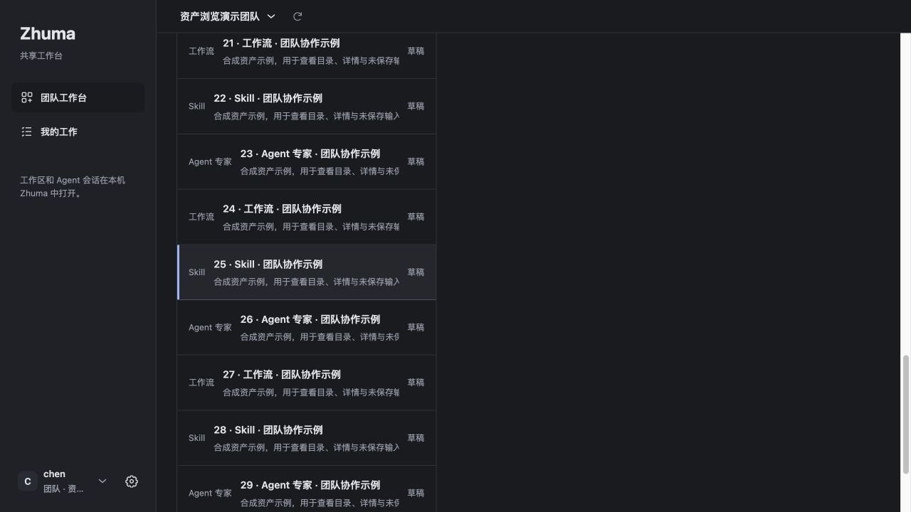
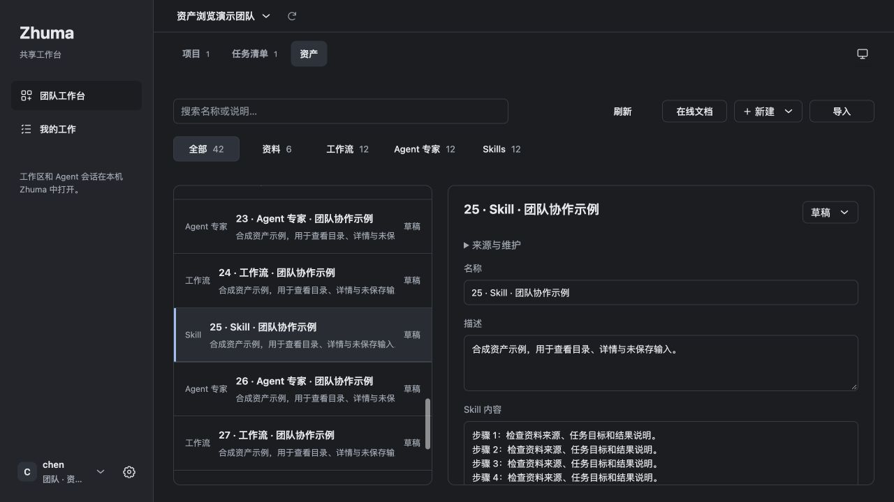
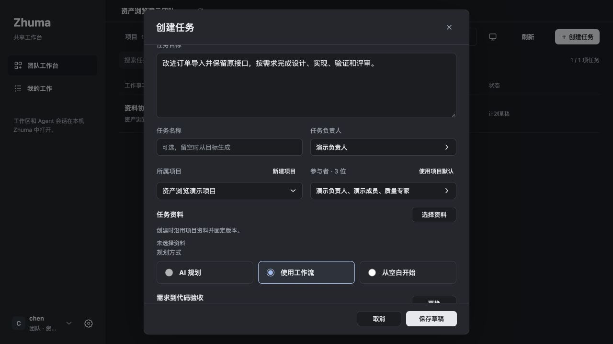
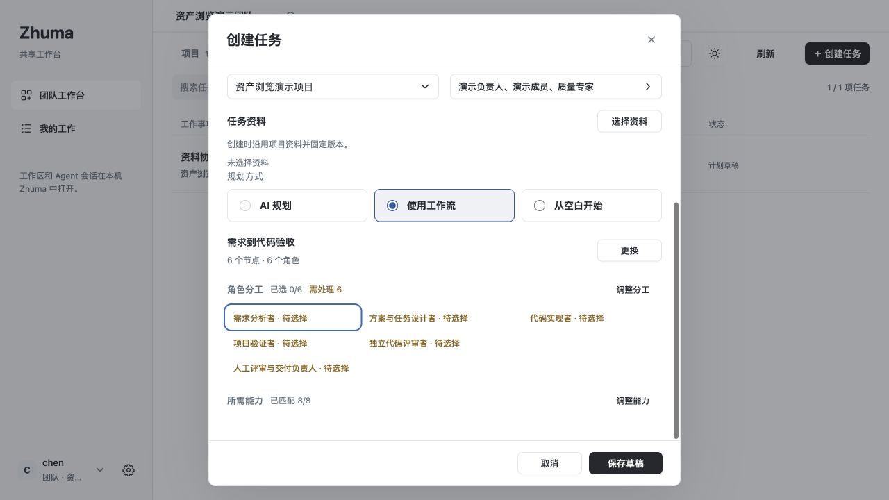
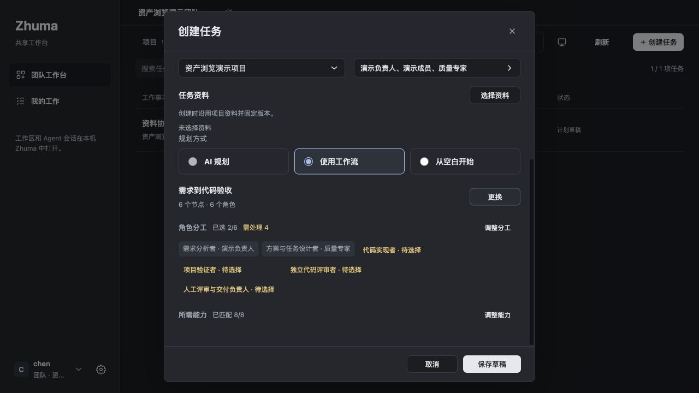
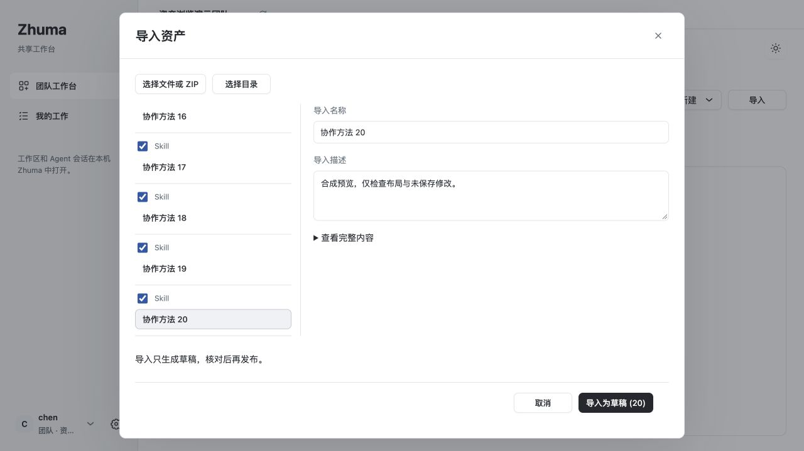
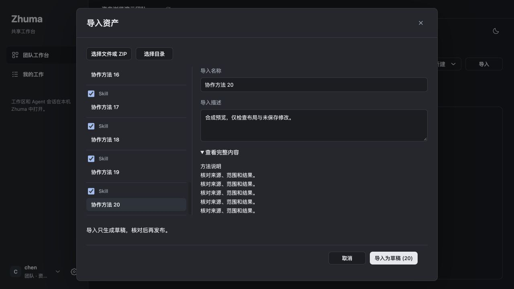
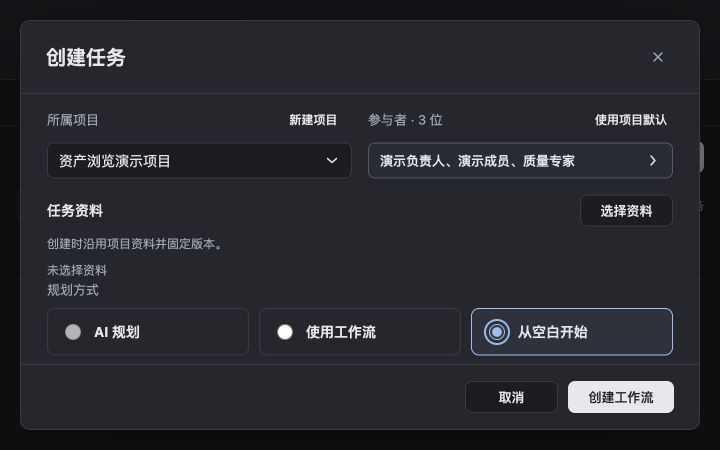
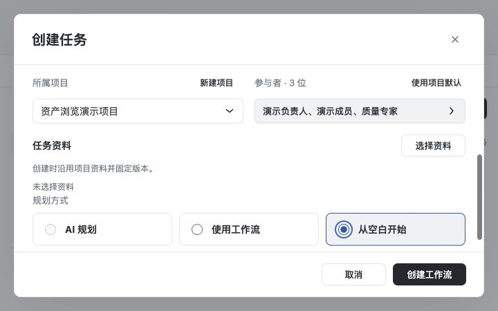

# Asset panes and task creation UI evidence

This evidence is generated from neutral, isolated fixtures and normal browser mouse/keyboard interaction. It contains no user attachment, credential, private project or original profile data.

## Exact sources and boundaries

- Before: `d0530a90a9db1226129548005fd38be89bbcc328`, tree `c244c2aa778753f972bb6c8f05677ca73534fdc9`.
- Independent panes and simplified creation: `a06b98c034a53ded7111aa8191987736b28cbabf`, tree `b651eb4c93282eb1dc7149c9f3492df6cb5f24cc` (#404).
- Keyboard visibility: `a99d88666a68962553c0c737c9fa45768de3e598`, tree `e75fc9a310a441c8cb84d1099f21c425df458fd2` (#408). Its #406 parent changes only the browser contract; the #408 increment changes only scroll margin in one CSS rule.
- Actual Client Web entry and Client codecs are used with synthetic HTTP fixtures; all business writes are rejected. The synthetic import preview passes the public preview DTO codec. This is not ZIP parsing, Host authorization, storage persistence, SDK, model, installed application or complete workflow proof.
- The before/after asset fixture SHA-256 is `c4e20adbb626d65bcc0a205ddc09d485762f204f5a45f30adfa7fc6ff670cec4`. The original a06 after bundle is `3c7897a738e7090547d4eb28bc62ccbe21211a9f0423fdd9a0f4826c79e92262`; the a99 after bundle is `53ad1c787e9a94c5d15324359d19d6aa9c76d6ecd8e8e155099d8d8206cbaf3a`.
- These screenshots bind to their listed topic sources. Header theme removal was separately accepted in #402; the a06 backdrop is not presented as the final combined release UI.

## Design and observed behavior

The design uses an overview followed by user-requested details, consistent with the [Carbon disclosure pattern](https://www.carbondesignsystem.com/building-blocks/core/patterns/disclosures) and its [longer-form guidance](https://www.carbondesignsystem.com/building-blocks/core/components/form/guidelines). Existing components are reused; no additional UI framework is introduced.

Task creation starts with the goal, optional name and owner. A chosen workflow shows role and capability summaries; explicit adjustment expands the original controls. Missing selections and unavailable resources remain directly actionable. Selected/matched resource counts are not claims of runtime readiness or authorization. Empty MCP hints are removed; existing actual bindings remain available in expanded details.

At 1280×720, the list and detail each scroll within their own panes. Selecting a lower item brings the detail to its top and focus without moving the page. Existing unsaved-change handling and per-item import edits are retained. Narrow or low windows use normal page scrolling without horizontal overflow.

At 720×450, normal Tab reaches the complete final planning-option label above the fixed footer in both themes: label bottom 355.578125, footer top 364. The form itself stays at scrollTop 0 and the footer stays fixed. Reverse Tab can reach the owner selector; Enter opens its nested chooser and Escape closes it with the task goal retained. Temporary browser viewport overrides are reset after verification. The CI contract remains separate from these normal UI observations.

## Asset selection before and after

Before, the right detail is above the visible page after selecting a lower list item:



After, the list and detail remain independently usable:



## Task creation overview and explicit adjustment







## Import list and detail panes





## Complete last option after normal keyboard navigation





## Image SHA-256

```text
3bc9da9f9e2df61ddb04c30353b7e667912e02f9bdb998f24a09456ee95fda04  before-lower-selected-dark.jpg
2580205acc9ae426cd054c3a8bac40882bfefcea232b813ce4a8be553ff32fb7  after-a06-lower-selected-dark.jpg
dda252b6939a2c81269d0618597b85fef81fdef0b2e9f8801bd3ef231f9fc87d  after-a06-create-summary-dark.jpg
36d20a5943aafdfd9b688ab35a110ccf481aa45ca92a9c02fa540c1b346ba259  after-a06-create-summary-light.jpg
e0d066a892db30d3acf92a60b1cd35176c64637905f79b22c80bbd27e14364c6  after-a06-create-bindings-dark.jpg
b4129173c93a54851b70399779cb49f29982ef29f06518e2ca3c5bd978bc40ce  after-a06-import-split-light.jpg
9ad8f8e4ccd21d562351dec717debb213195c6cb51e6a1b42f8352f2dce8752a  after-a06-import-split-dark.jpg
d610a1853acc86059253c70767a276f9203b9d362345e20f90123308ac8828f8  after-a99-create-focus-dark.jpg
e03ff2e10f201c821a436326fcdbb5a759447a0f9b717eaa8766db1c1b9c9ae6  after-a99-create-focus-light.jpg
```
