# 执行客户端交接前后图

这组图片服务于 PR #73 的客户端切片评审，均从实际 React 界面截图。

- 前：未合入的交接来源 PR #60，源码与样式为 `9a872a4c5b1ec9275f0f6a0da760eac4296ad3d0`。它不是已发布产品或 develop 的现有执行界面。
- 后：PR #73，源码与样式为 `8304f2699121bb5592a19c62c9b5156232a3e493`。
- 两边复用同一份执行客户端浏览器预览夹具、虚构订单数据和输入；视口均为 1440×900，分别采用浅色、深色，保留预览控制栏。
- 场景为待办工作区、填写评审意见、填写文字与参考链接交付。新增显式启动、明确操作列和当前轮次产物，收拢无效文件元信息表单，主题链接及键盘焦点采用现有令牌。

`manifest.json` 记录图片名称、实现版本、字节数和 SHA-256。图片只证明客户端呈现；RPC 为预览夹具，不证明正式 Host、真实身份／空间授权、磁盘持久化、文件字节、模型或安装版验收。

## 浅色

| 场景       | 前                                               | 后                                              |
| ---------- | ------------------------------------------------ | ----------------------------------------------- |
| 待办工作区 | 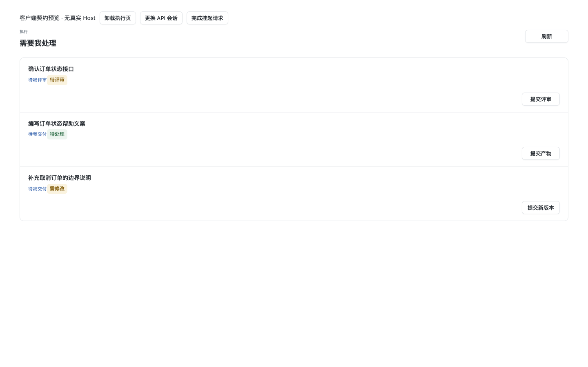 | 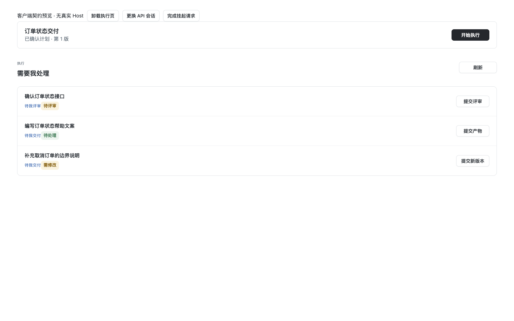 |
| 评审       | 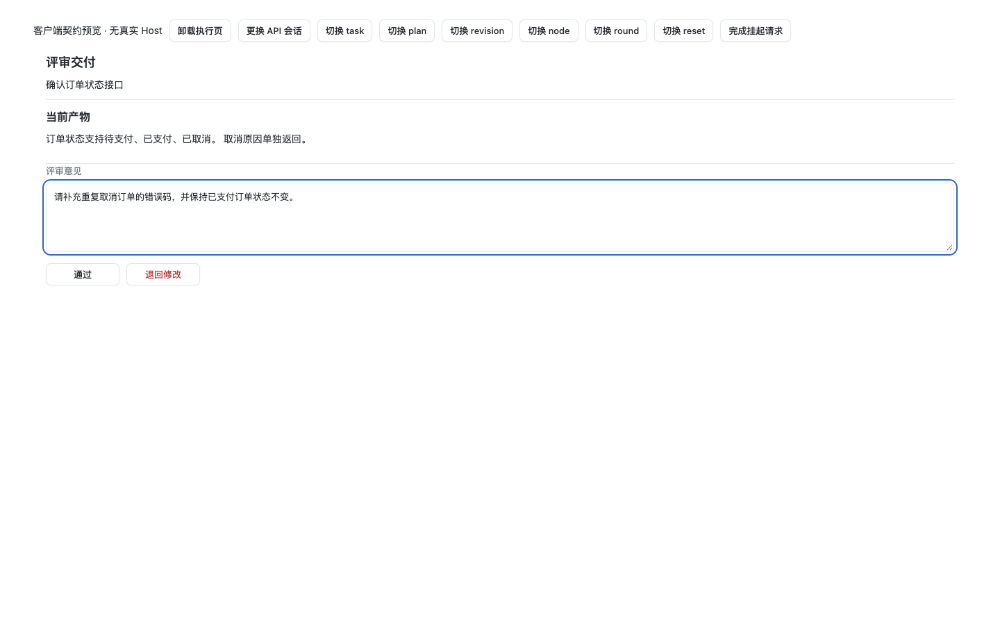    | 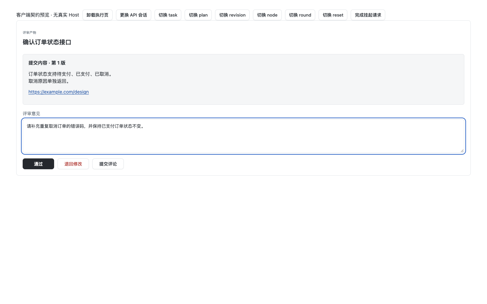    |
| 文字交付   | 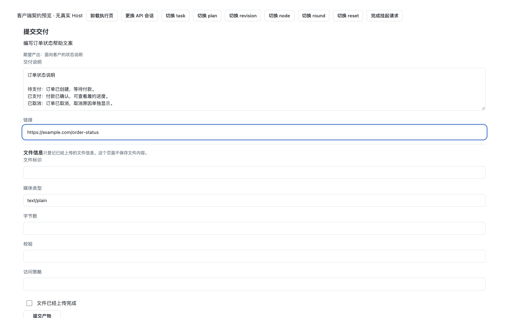  | 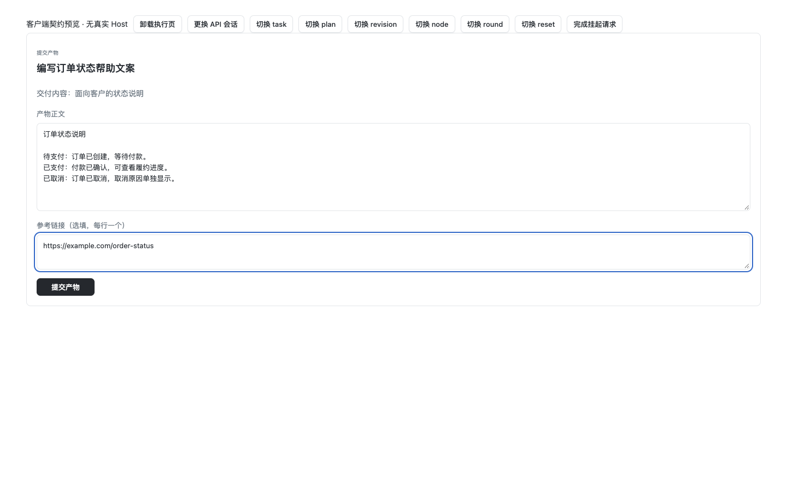  |

## 深色

| 场景       | 前                                              | 后                                             |
| ---------- | ----------------------------------------------- | ---------------------------------------------- |
| 待办工作区 | 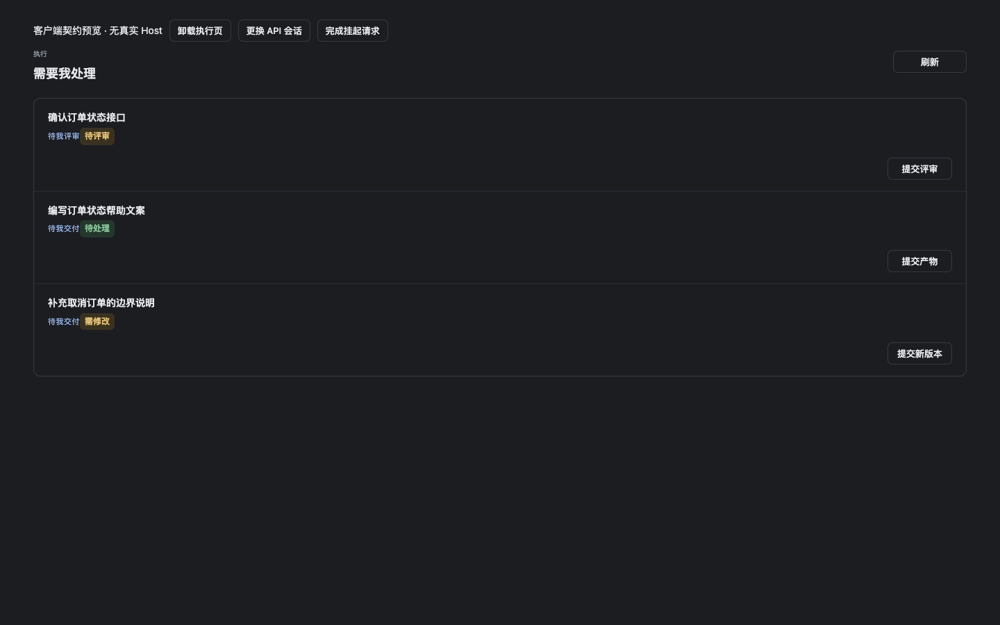 | 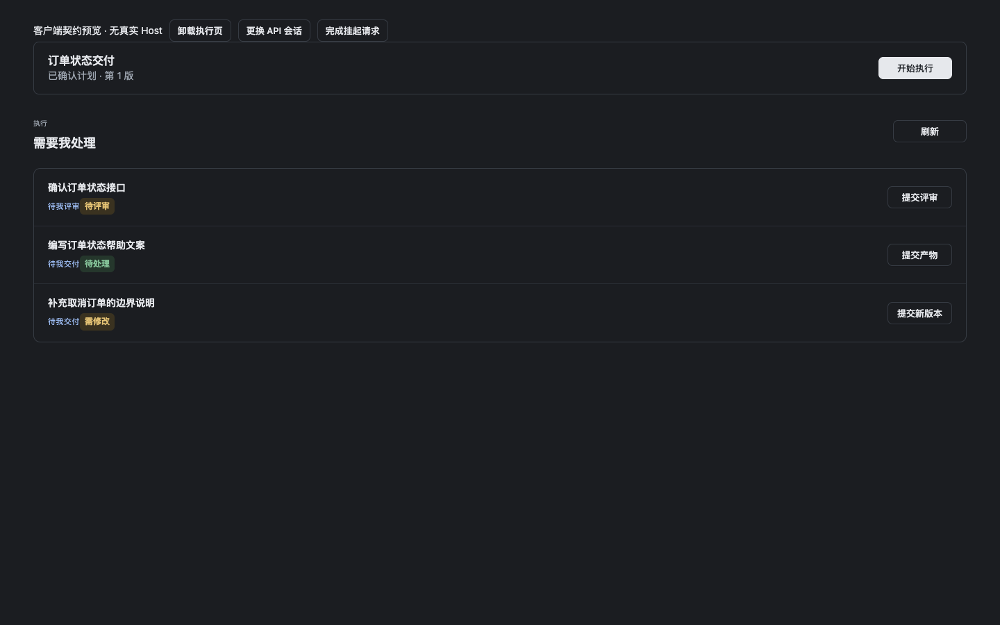 |
| 评审       | 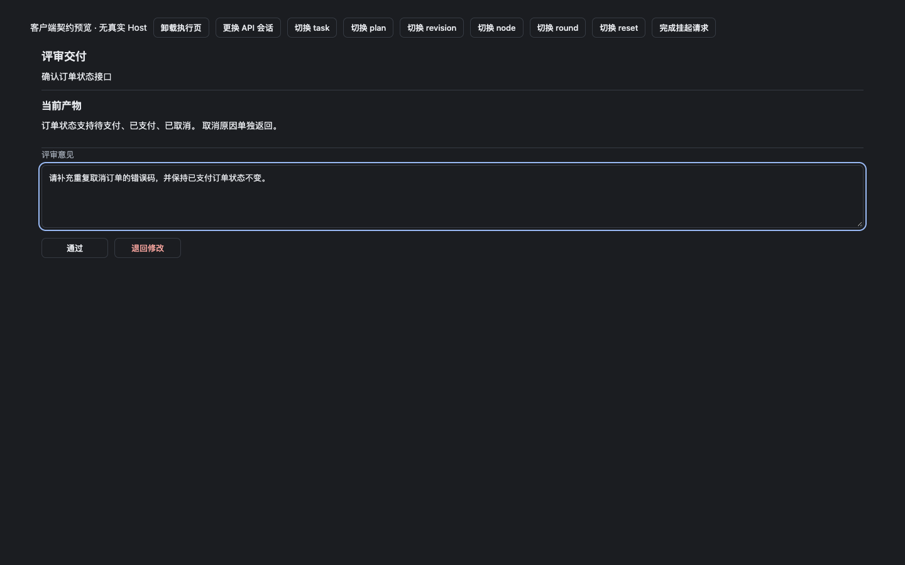    | 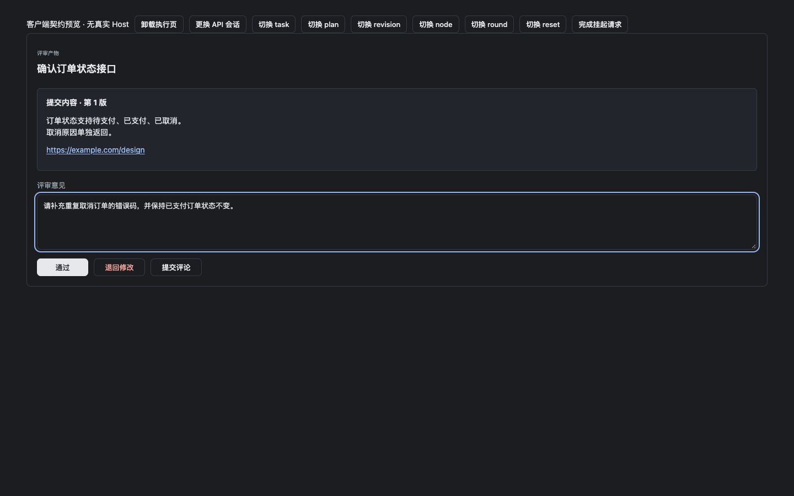    |
| 文字交付   | 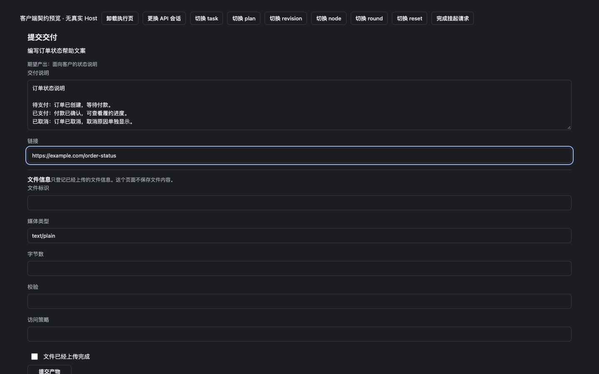  | 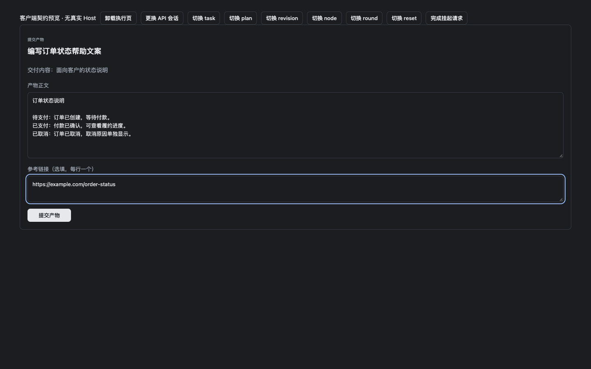  |
