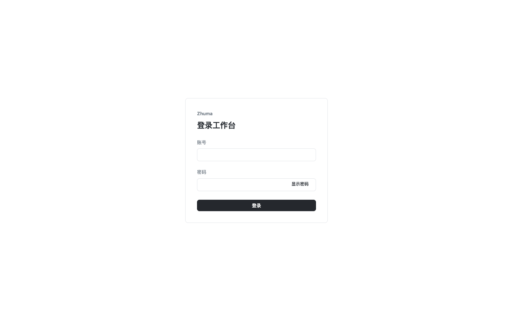
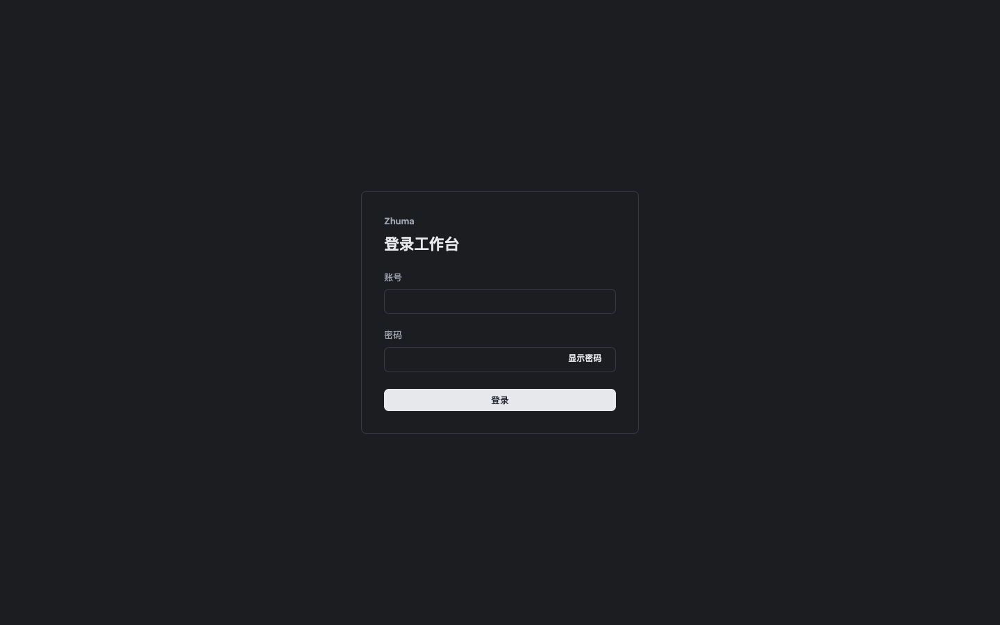
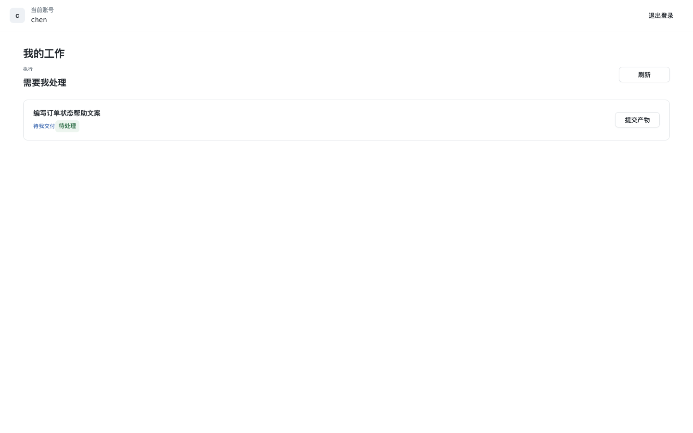
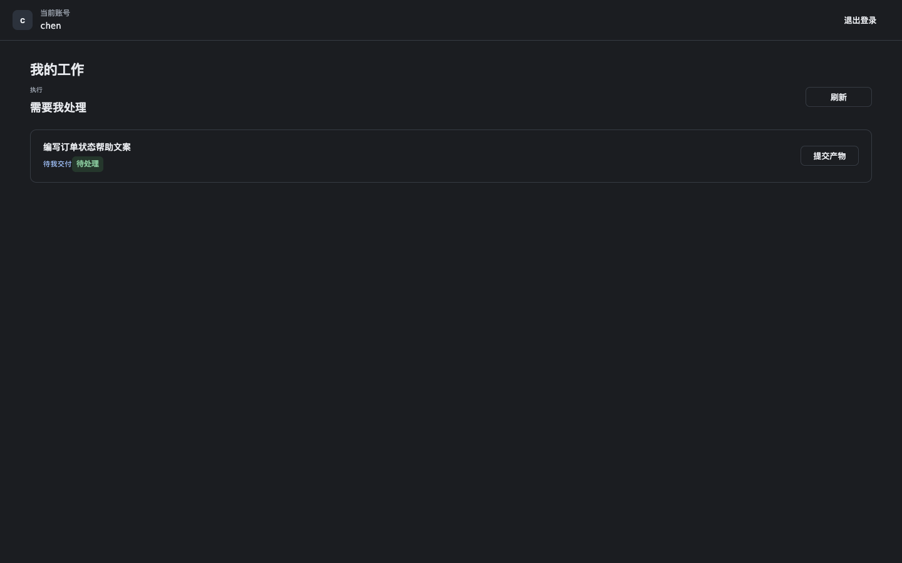
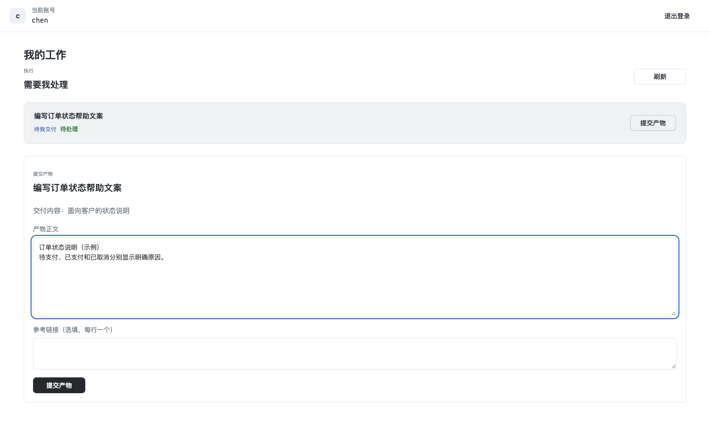
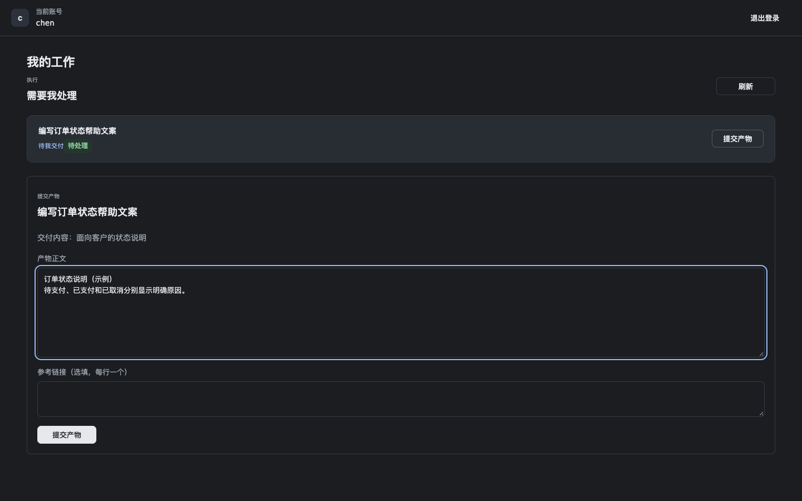
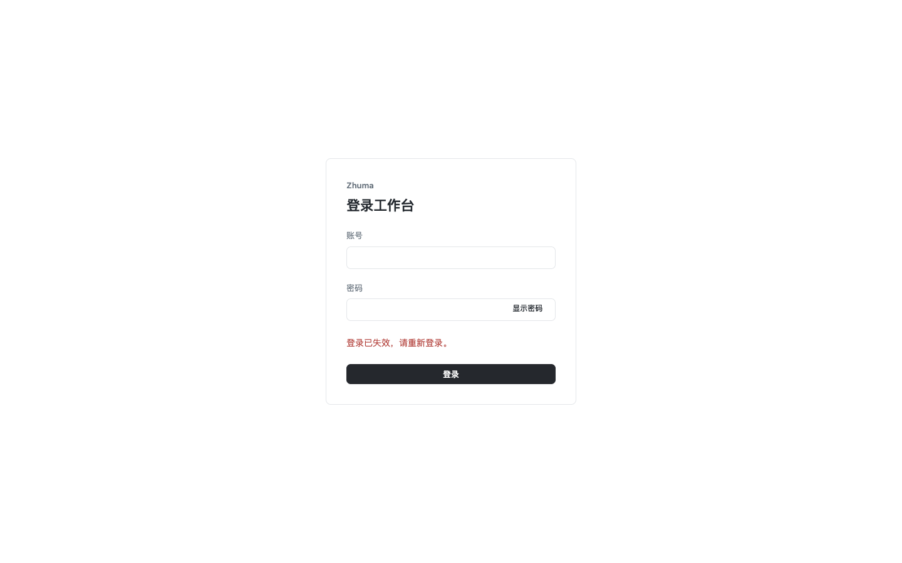
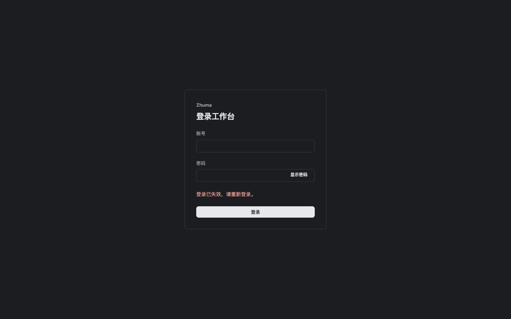

# 新增成员执行入口预览

这些图片来自 PR #77 的真实页面组件，源码为 `5688bf91a21c5d98858068f90d98932c9d355b67`。
develop `ad8a9e22` 没有同等的成员登录保护执行导航，因此本组没有伪造旧页面，展示新增功能的四种状态。

使用同一份虚构账号和订单数据、1440×900视口，分别检查浅色和深色：登录、当前成员待办、填写交付、会话失效后移除工作输入。
HTTP身份和执行响应为浏览器契约重放，没有发出执行命令或访问旧工作台接口。没有实际点击已安装桌面侧栏；导航注册由源码和正式构建另行核对。
这些图片不认证真实成员Cookie、授权目录、正式Host持久化、模型或安装版。真实服务过程与图像证据分别记录。

`manifest.json` 包含版本、场景、字节数、SHA-256及请求边界。

| 状态         | 浅色                                            | 深色                                           |
| ------------ | ----------------------------------------------- | ---------------------------------------------- |
| 登录         |        |        |
| 当前成员待办 |        |        |
| 填写交付     |     |     |
| 会话失效     |  |  |
