# A-PROJECT 首批证据

实现检查点 `83ab30340a0fa66dea2fb4e63e3ed74c9cf3f549`，基线 `8ac6cb42c326db405f672ac55d33f219d19bf284`。交互、兼容和未完成范围见[项目入口](../../project-hub.md)。

## 检查与契约

- `pnpm check`：190/190。新增项目定义／规划 3 项和服务 1 项：旧形状不注入字段、合法引用／不安全 URL／重复与悬空 ID、修改项目不改已有任务与确认快照、关联资产进入预算、链接正文未抓取、任务参与者不扩大，以及失败重试／同键重放和序列化重载。
- `pnpm test:ui`：完整浅深 88/88，其中项目专项 10/10。覆盖四入口、项目任务筛选／返回、未知成果、修改失败同键重试、默认人选／资料重开、换项目不覆盖人工选择、显式重置、新建项目立即创建、AI 失败同一项目、长内容及 720×600 无横向溢出。
- 浏览器为公开虚构响应重放；服务测试为存储端口契约，不冒充真实账号、Host 进程或模型。

## 同数据对照

修改前 bundle／浏览器 harness 在修改 UI 前缓存并记录摘要。两版使用完全相同的 `replay.fixture + prepareProjectHub`，为兼容旧严格 schema，**两边都去除新增项目可选字段**；视口 1440×900，浅深色媒体，操作同为工作台 → 项目 → 订单门户。旧版进入筛选后的任务清单，新版进入项目概览，不伪造旧版详情。数据摘要与 harness 摘要见 [baseline-proof.json](baseline-proof.json)。

| 相同项目点击后的旧界面                 | 新项目概览                            |
| -------------------------------------- | ------------------------------------- |
| 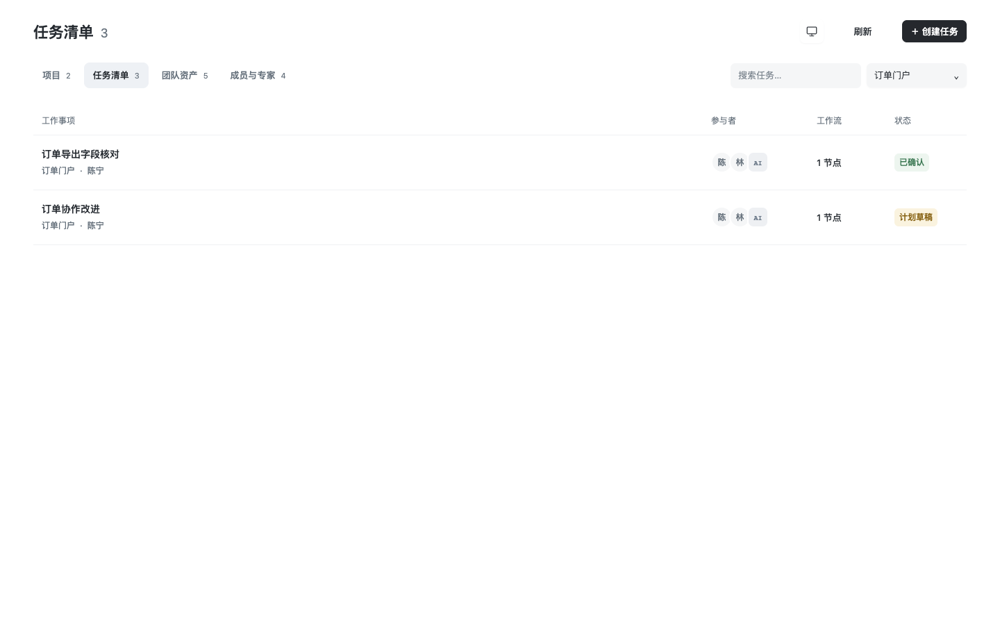 | 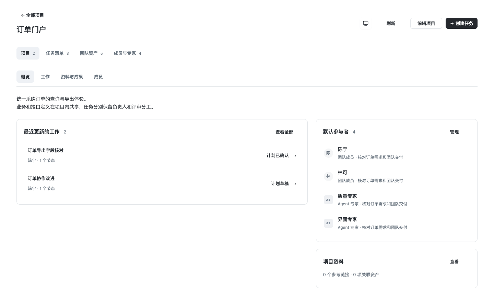 |
| 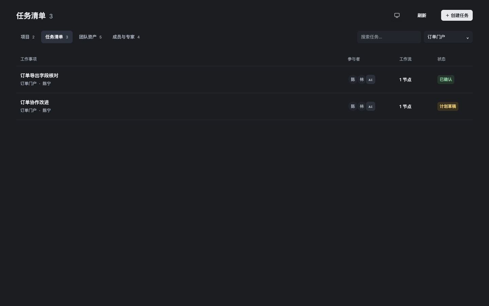  | 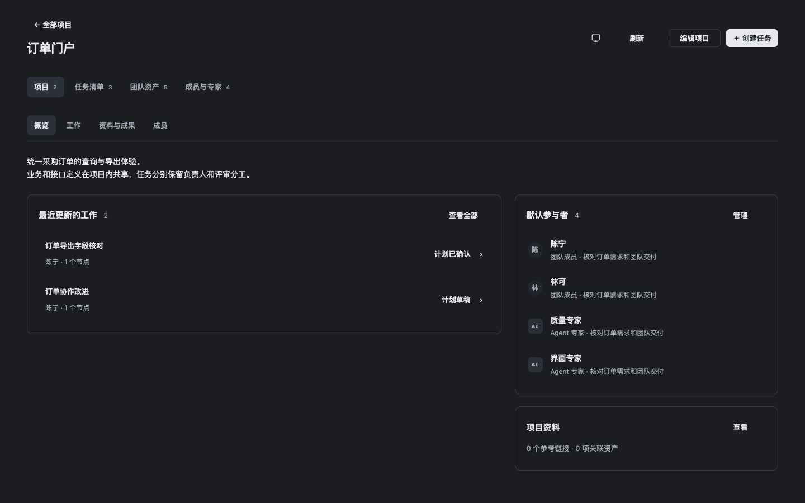  |

以下为**另一个已配置新字段的交互用例**，不是上述基线对照的数据状态：

| 概览                                     | 资料                                      |
| ---------------------------------------- | ----------------------------------------- |
| 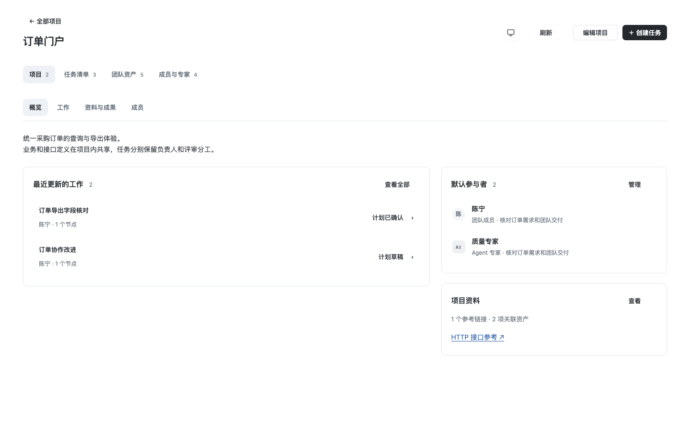 | 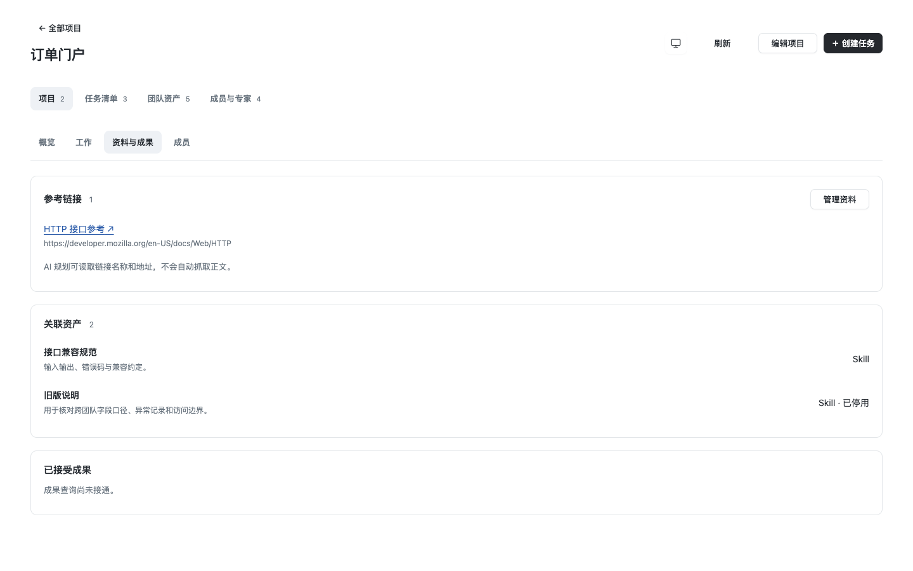 |
| 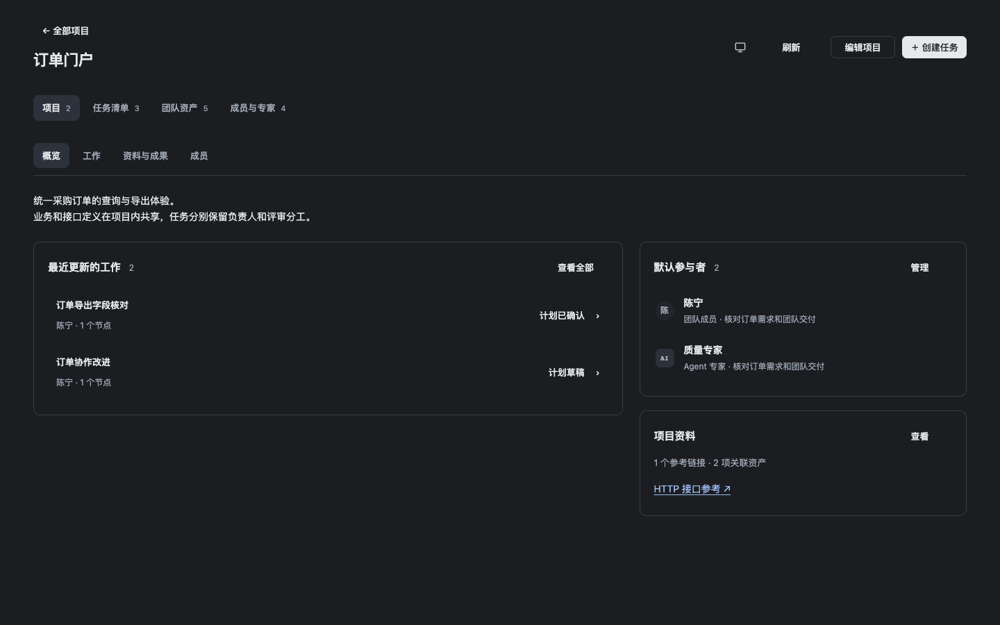  | 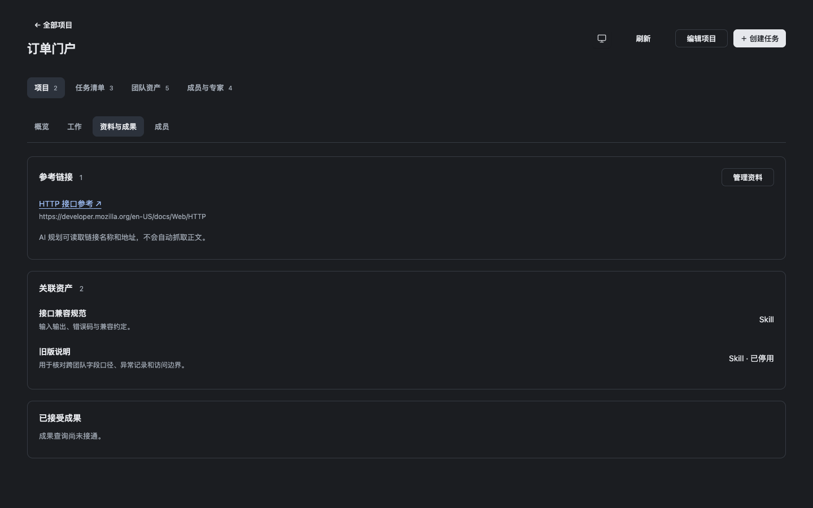  |

| 默认真人／专家展开                                | 720×600 长项目                        |
| ------------------------------------------------- | ------------------------------------- |
| 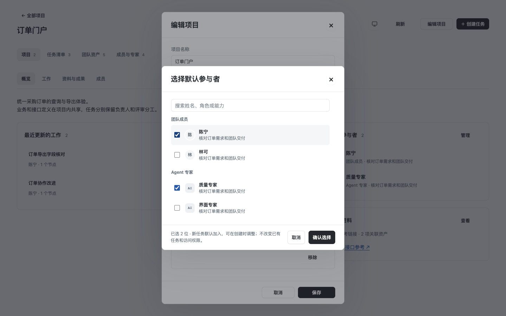 |  |
| 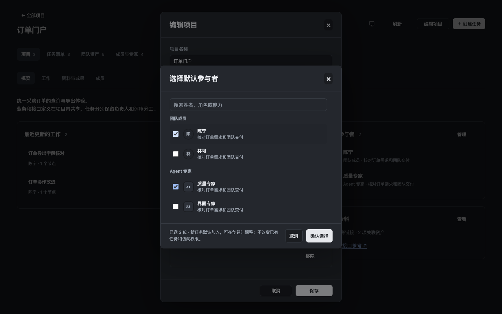  | 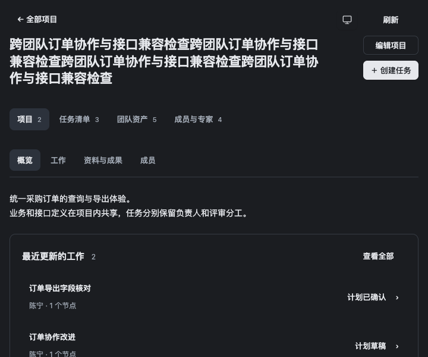  |

## 独立官方桌面

复用官方 DSH 的自有隔离验证应用、全新数据／profile／空工作区；不操作日常窗口，不调用模型。基线和新版初始数据均为同一旧形状公开数据；仅新版经正常 UI 配置新字段。

正常侧栏 → 项目 → 查看详情 → 保存默认陈宁／质量专家、关联同一 Skill、参考链接 → 项目内人工创建任务并继承默认参与者 → 返回项目 → 完全关闭并冷重开 → 资料与任务仍在。真实存储为两个收据，旧三项任务完整不变，新任务仍是同一项目 ID，规划审计 0 条。修改前、新版、重开 Client 实际加载字节与对应构建匹配，Host 摘要分列，详见 [native-proof.json](native-proof.json)。

1280×800，zoom 1、显式深色，标题实际计算 22px，无横向溢出。原生图片含设备像素比；不从截图像素推断字号。

| 旧入口                           | 新概览（相同初始数据）           |
| -------------------------------- | -------------------------------- |
| 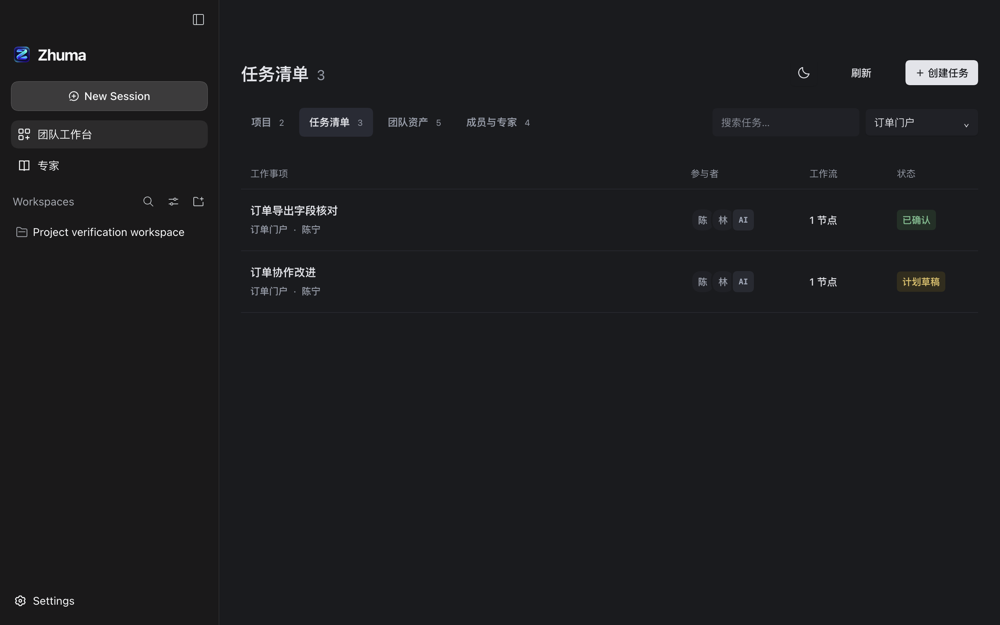 | 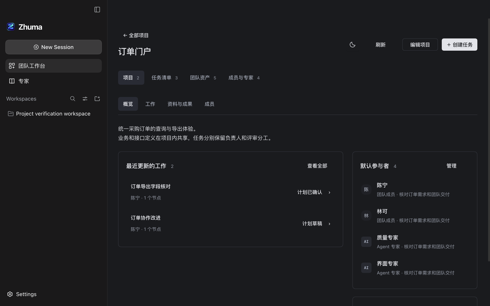 |

| 配置／创建后的项目                 | 冷重开资料                     |
| ---------------------------------- | ------------------------------ |
| 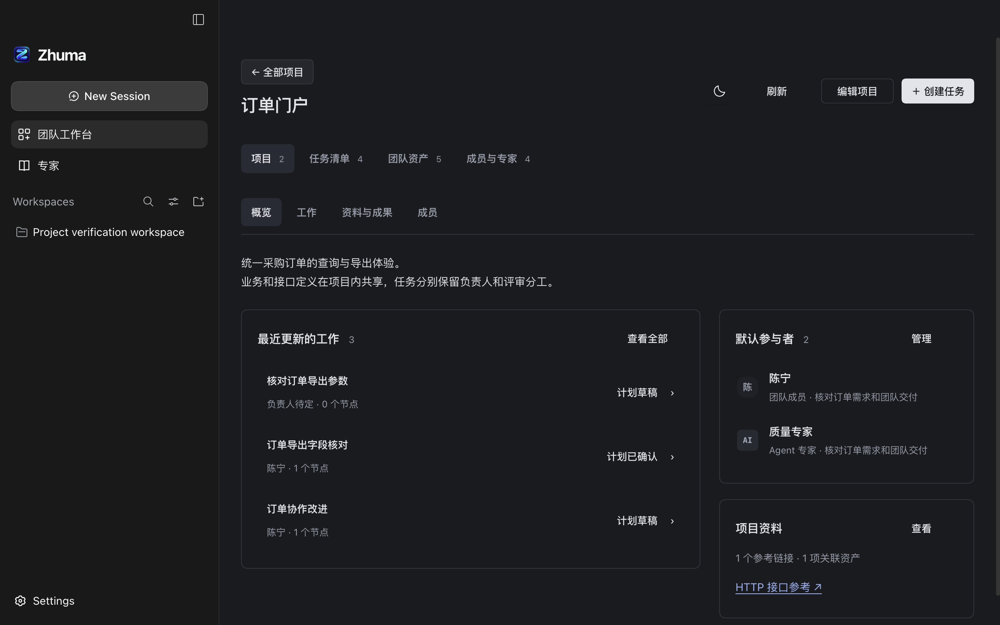 | 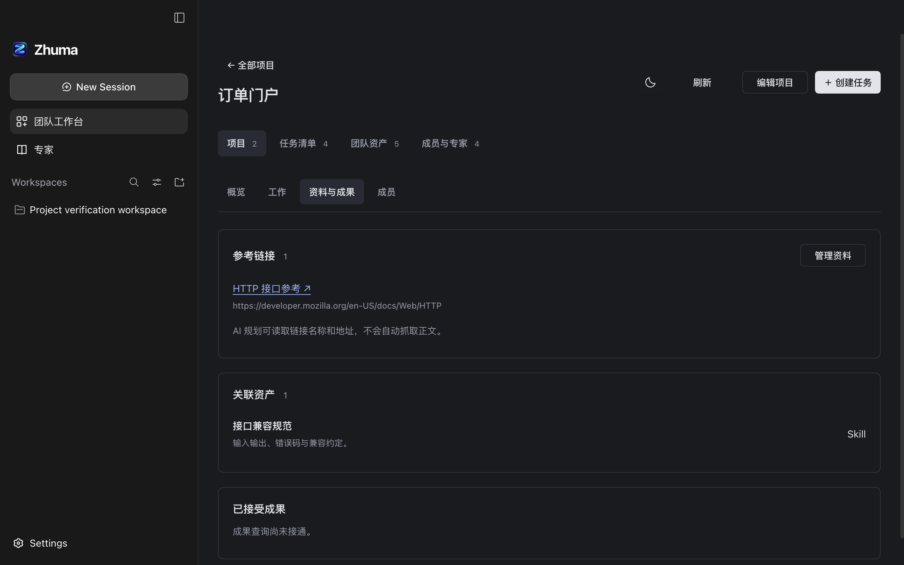 |

未认证：正式产品身份／空间权限、多人协作、执行阶段／产物查询、Agent／模型质量、资料正文抓取／文件物化、项目归档／运行期职责变更、安装版、系统主题切换、拖窗或 Windows/Linux。
