# A-UX2b：工作树定位与层级导航

修改前基线：`d8a161a`。修改后为本目录所属 PR 的实现版本。使用同一份 [三层工作流 fixture](../../../tests/fixtures/workbench-tree.mjs)：普通任务清单中的“订单与结算协同交付 · 演示数据”，14 个节点、4 个工作流、3 层及并行分支。没有另建演示专区，没有执行成功或产物数据。

图片运行真实工作台组件与 CSS，静态浏览器 harness 重放快照，不调用模型；不代表官方 Host 或安装版认证。1440×900 为定位和全图；720×600 为同一任务侧栏。浅深各一套。修改前导航位于已有全树入口，修改后保持相同“异常数据处理”选择；新增搜索/层级栏在旧版没有对应控件。

| 场景                      | 修改前                         | 修改后                        |
| ------------------------- | ------------------------------ | ----------------------------- |
| 当前节点与上级路径 · 浅色 | 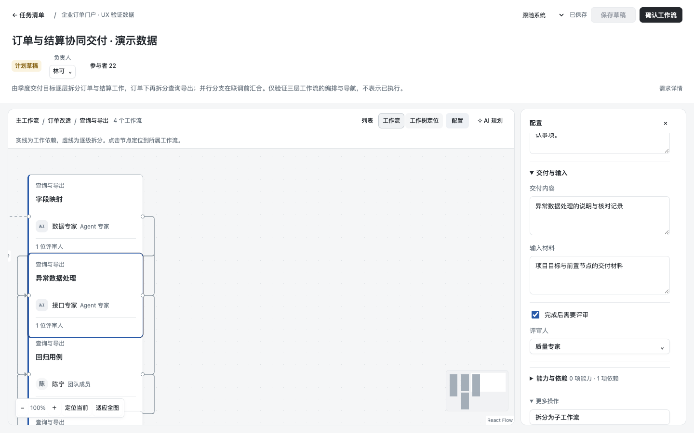     | 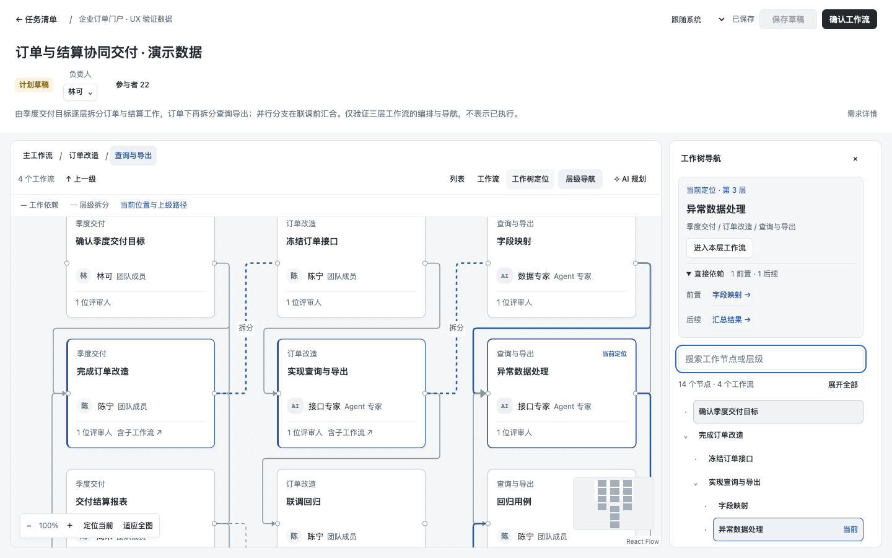     |
| 当前节点与上级路径 · 深色 | 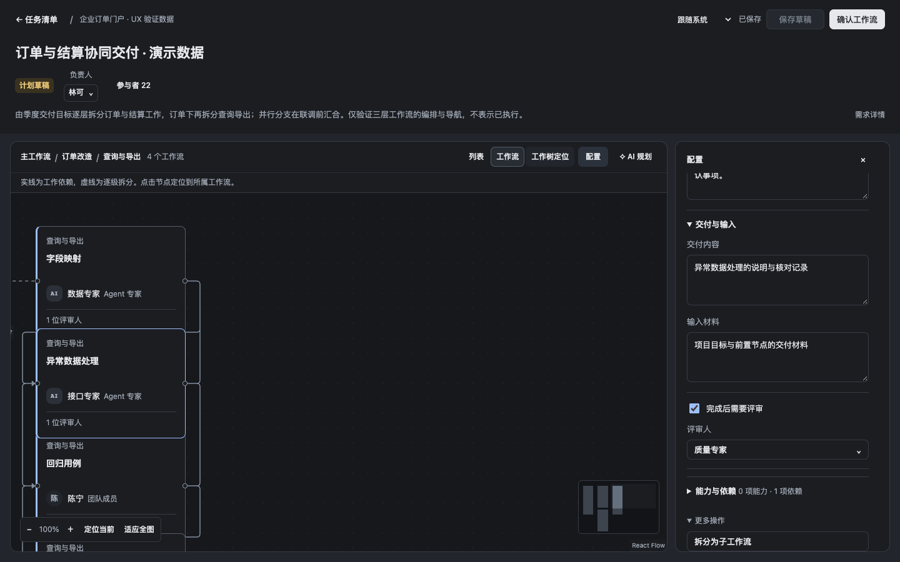      | 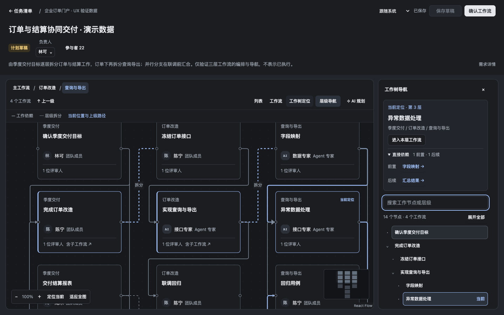      |
| 全图概览 · 浅色           | 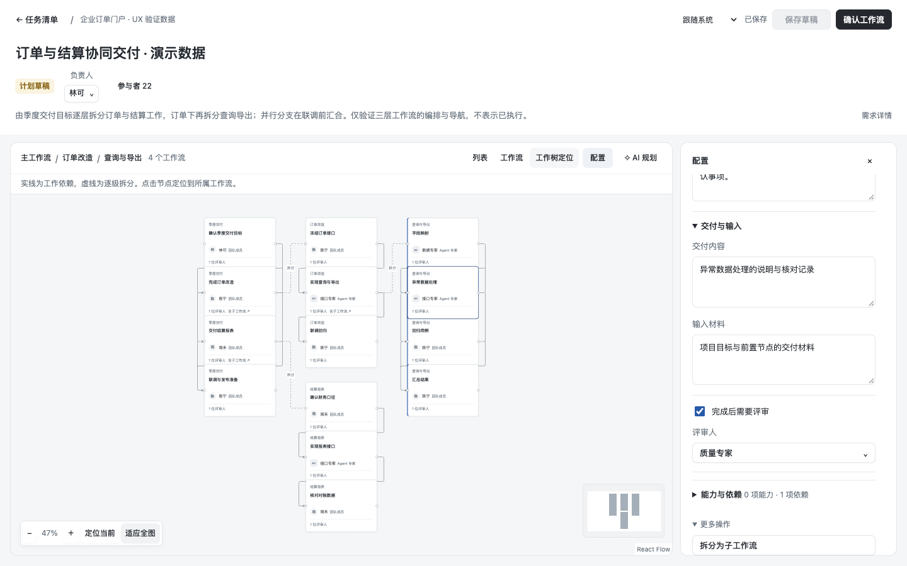 | 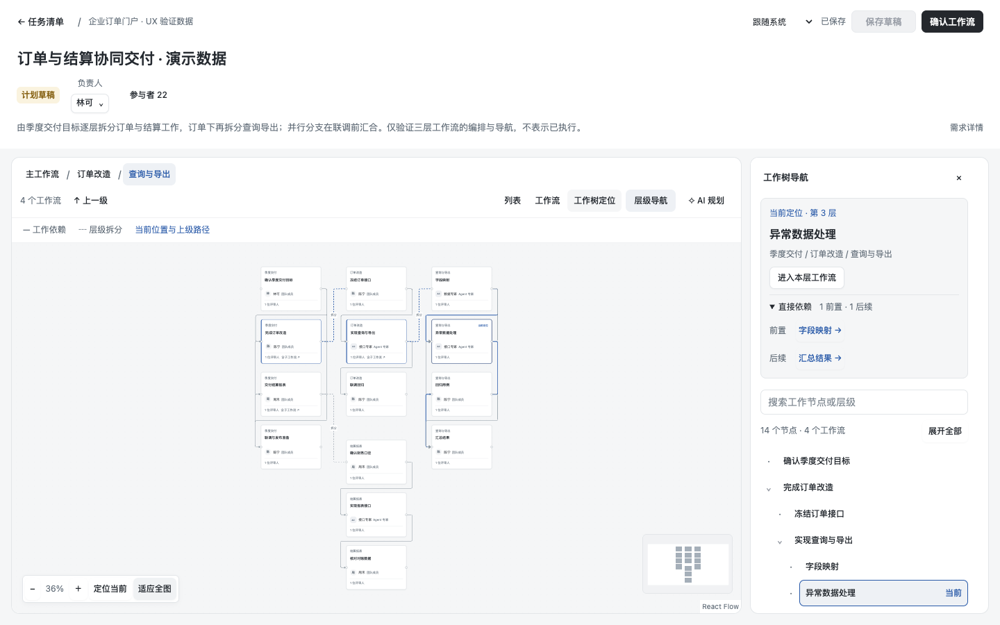 |
| 全图概览 · 深色           | 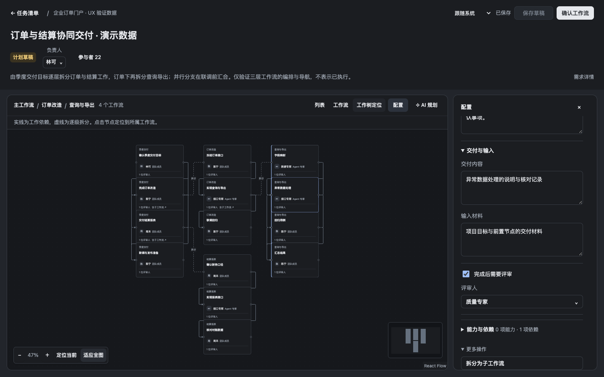  | 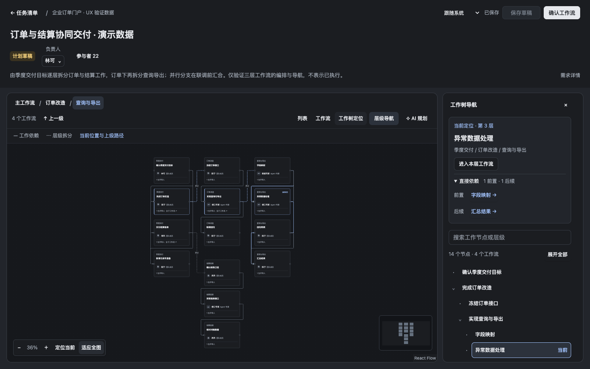  |
| 小屏侧栏 · 浅色           | 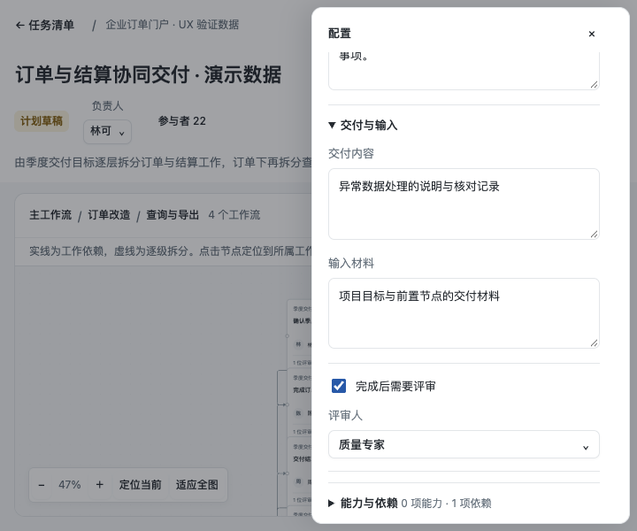  | 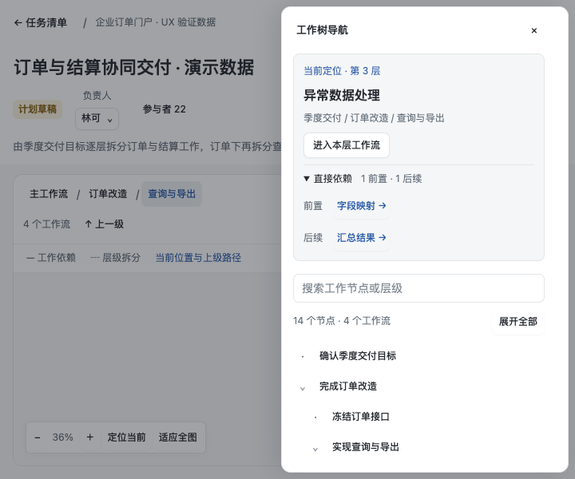  |
| 小屏侧栏 · 深色           | 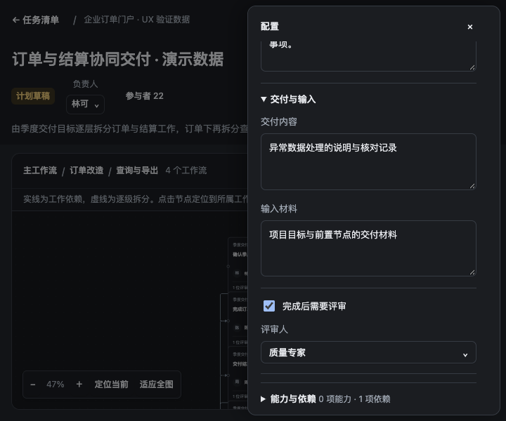   | 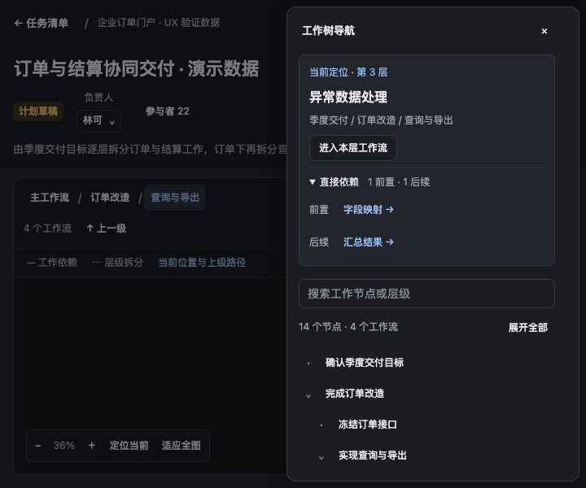   |

浏览器行为检查覆盖全树选择保持、每层选择恢复、搜索不移动定位、折叠后搜索展开、直接前后依赖、保存重开、最新版本删除子树后回退、键盘操作和小屏焦点恢复。操作前后计数断言导航不产生保存或规划请求。纯导航测试检查合法三层并行数据、最近可见上级回退、失效引用与不连通循环不进入可见索引。

另在已确认隔离目录的官方 DSH Host 验证：通过真实 command 导入 1 个演示任务，界面修改第三层节点并保存，刷新从任务清单重开确认持久化，再恢复节点原名。2 次真实保存，导航命令数 0、模型请求数 0。原有演示项目/成员复用，没有修改其定义。

当前树是单个任务内的工作流定义。跨任务权限树、子任务执行、产物传递、评审推进不属于本批；没有权威执行报告时仍显示计划草稿或“待执行接入”。只能从传入任务快照的可达节点构建导航，不能据此声称多用户权限已完成。
